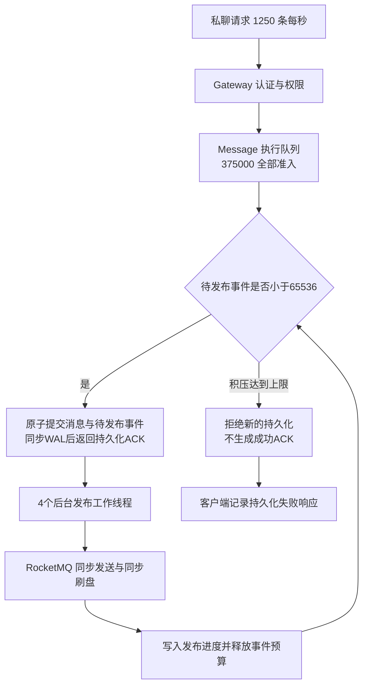

# TinyIMX 最近压测失败的原因与修复验证

本次逐轮核查确认：真实容量失败发生在待发布事件的有界准入保护，原始 WAL 证明积压曾达到 65,536 条；另外三次启动失败分别来自检查文件名冲突、实际执行了旧版 MQ 编号校验、重启后磁盘盘符变化。实验盘检查异常还暴露了恢复流程的错误耦合。

批量候选已经完成并判定失败，默认批量开关未改变。候选退出后原有 20 个服务恢复，4,444 个既有容器与原数据保护检查通过。有限消息独立诊断及离线原数据核验已完成，当前组合的不兼容已在三个实验入口提前拦截。

## 各轮实际发生了什么

| 问题与轮次 | 实际失败点 | 是否发出业务负载 | 原因 | 已执行动作与验证 | 下一项验证 |
| --- | --- | --- | --- | --- | --- |
| PERF-1753，R1745 p2，20K / 2,000 条/s | 第 284.790 秒触发宿主机 6 GiB 保护线 | 已发压，计划 600,000 条未完整完成 | 宿主机可用内存最低 5.8445 GiB；旧控制器直接终止发压器，丢失最终汇总，另有真实发布积压 | 独立核验全部 403,573 条实际持久化消息；恢复 50,806 条待发布和 17 条待确认，最终全部接收确认；新发压器接入受控停止与终态落盘 | 在新客户端上继续提高成功速率，同时保留资源保护和全部失败分母 |
| PERF-1762 r1，批量发布业务资格 | 检查结果文件已存在的断言 | 0 | 新验证复用了旧恢复实验的 `ident-r1745` 文件名前缀 | 改用独立 `wire-r1762` 前缀；r2 完成真实 207 项业务、23 项 MCP、独立归档恢复及原服务保护 | 性能收益由实际同负载结果决定 |
| PERF-1766，R1751 p15 | MQ 就绪程序拒绝新轮次 | 0 | 实际程序内嵌旧的第 1–4 轮范围，资格检查却读取了另一份已扩展至 1–20 轮的 Java 文件 | 执行和资格检查统一读取同一源码；资格程序直接求值实际执行的替换表达式；真实运行 100 项就绪边界检查及原 124 项 MQ 约束 | 新 p1 已成功完成全部 375,000 次计划发送，证明启动故障已修复 |
| PERF-1767 / 1770，R1751 p1，20K / 1,250 条/s | 从第 188.644 秒起返回持久化失败 | 375,000 次计划全部发送 | 发布服务能力低于事件产生速度，待发布事件达到 65,536 上限，新事件准入失败 | 核验 352,120 条成功消息全部持久化并接收确认；22,880 条失败未产生额外持久化；真实 WAL 重建确认峰值 65,536，全部原文件不变 | 批量单因素候选已失败；修复并验证真实 LOCAL 回执兼容后，继续验证发布持续能力 |
| PERF-1768，R1751 p16 r1 | 重启后的实验盘身份检查 | 0 | 原根分区从 `/dev/sda5` 变为 `/dev/sdb5`，脚本错误地固定盘符；两块磁盘 UUID 与 SCSI 配置均未改变 | 同时校验 UUID、112 GiB 容量、SCSI 槽位、真实根挂载与分区号；实际成功挂载；两种盘符顺序及 14 个错误身份拒绝检查通过 | p16 r2 使用修正后的守卫继续同负载验证 |
| PERF-1769，p16 恢复分支 | 实验目录访问异常后跳过原服务启动 | 0 | 目录清理、源库检查和原服务恢复被放在同一个异常分支中，前一步错误中断后续恢复 | 新增独立原服务恢复分支，先证明原服务挂载不依赖实验盘；受控目录异常下真实执行原 20 服务幂等恢复通过；原实验失败判定继续保留 | 后续异常分支继续保存独立恢复结果，恢复成功不覆盖实验失败 |

## 真实业务容量失败的直接证据

控制组参数是 20,000 个认证连接、每秒 1,250 条私聊消息、300 秒、128 B 正文。全部请求进入 Message 的执行队列，`accepted=completed=375000`，队列准入拒绝数、执行器失败数均为 0。

| 实际结果 | 数值 |
| --- | ---: |
| 计划并实际发送 | 375,000 |
| 完整成功 | 352,120，93.8987% |
| 持久化失败响应 | 22,880，6.1013% |
| 客户端超时、内容错误、未调度 | 均为 0 |
| 重复投递帧 | 16；未产生额外持久化消息记录 |
| 成功消息接收确认 | 352,120 / 352,120 |
| 关闭时发布完成 | 310,247 |
| 关闭时待发布 | 41,873 |
| WAL 重建的待发布峰值 | **65,536** |
| 虚拟机平均忙核 | 5.8581 / 8 |
| 宿主机最低可用内存 | 8.3366 GiB |
| 虚拟机最低可用内存 | 11.5905 GiB |
| 虚拟机换入、换出 | 均为 0 |
| RocksDB 写入停顿 | 0 |

该轮资源保护全部通过。失败响应平均 8.514 ms，P99 为 36.645 ms，属于已经收到的业务失败响应；它们没有从分母中删除。

当前失败由以下路径触发：

源码中的上限来自 `LocalPrivateStoreOptions::max_pending_events=65536`。`EventSlot` 在写入新消息前预留事件预算；预算满时返回 `kFailedPrecondition` 和 `local pending event capacity reached`。原子写入之前的拒绝没有生成消息记录，这与本轮独立存储核验一致。

原始 WAL 尾段提供了直接复核。独立只读程序校验连续序列 6,606,203 至 6,648,494，解析 2,017 个写批次，从最终 41,873 个真实 `E/` 事件键反向撤销新增和发布删除，重建出峰值 **65,536**；其中 109 个批次边界的积压至少为 65,530。实际存储 15 个文件在检查前后的长度与 SHA-256 全部一致。

平均 CPU 没有达到 8 核，是因为吞吐同时受同步 RPC、同步刷盘与发布并行度约束；积压准入保护也会让部分新消息提前失败。CPU 剩余并不意味着这条发布链路仍有足够的持续处理能力。

## 为什么客户端错误信息没有直接暴露积压上限

Message 把 `kFailedPrecondition` 映射为 gRPC `FAILED_PRECONDITION`。Gateway 的现有逻辑只要认为持久化 RPC 已经尝试，就统一返回 `message_persistence_uncertain`。因此，客户端记录保留了失败次数，却看不到“事件预算已满”的具体分类。

此外，退出日志中的 `success=1` 表示存储安全关闭，`drained` 指运行中工作已收尾；它没有承诺所有持久化待发布事件都已发布。本轮 `pending_events=41873` 明确表示仍有后续工作。验收已要求待发布为零，不能仅用退出成功判断容量通过。

这两处可观察性缺口，是此前难以从客户端汇总和退出状态直接定位问题的重要原因。后续诊断计数应在 Message 边界区分事件预算拒绝、执行队列拒绝、存储错误与 RPC 期限；保持现有 ACK、CID 幂等和不确定结果处理语义。

## 批量发布为何是本次对照因素

当前关闭批量发送时，4 个发布工作线程逐条执行同步 MQ 调用。源码已有批量发送实现，可使用已就绪事件组成至多 16 条的批次，复用原有工作线程、在途上限和发布进度流程，不新增等待收拢时间。

候选只对 Message 服务启用批量发送，20,000 用户、1,250 条/s、300 秒、相同持久化与资源门槛。全部 375,000 条请求发出，但仅 179,388 条完整成功，195,612 条返回失败。此轮判定失败，不能用成功部分的延迟作为容量成绩。

SDK 共提交 156,507 次批量 RPC，全部收到终态，同时全部报告回执无法匹配；2,497,937 个提交项含大量重试，绝不是业务成功数。关闭时仅 62 条发布完成，131,084 条隔离、48,242 条待发布。

独立只读审计逐一核验了全部 179,388 条消息的正文、CID、历史、未读及接收确认，全部通过，无未确认消息。每条隔离及待发布事件的完整原文与不可变归档 `A/` 完全一致，隔离原因全部为 `publisher_retry_limit`。原存储文件哈希不变。因此客户端成功消息没有丢失，但后台发布链路确实失败。

### 为什么 207 项业务检查没拦住这次缺陷

重新检查该次检查的原始日志，虽然显示 `wire_send_batch=1`，实际 `calls=rpc_submissions=submitted_entries=0`。顺序、小量的业务测试没有形成批量调用。因此它验证了功能，却没有验证启用优化后的多消息协议分支。

这是准入检查遗漏。此前把“开关已开启且业务通过”当作批量兼容验证，判断不充分。新增准入必须核对真实批量调用、当前 SDK 哈希、MQ 模式、逐条回执与实际 Broker 持久化，而不能只检查开关和用例总数。

### LOCAL 和 CLUSTER 的实现差异

已读取当前 5.5.0 JAR 的真实字节码。LOCAL `LocalMessageService.sendMessage` 在多消息分支构造 `MessageBatch`，为批次对象生成独立 UID，并从这个对象读取回执 ID；单消息则读取原消息的 UID。此前 CLUSTER 验证的成功批量回执是请求消息 UID 的拼接串。

严格的 SDK 不会用一个无法对应请求的批次 UID 确认所有事件，这是正确的保守行为。集成错误在于将此前 CLUSTER 的批量能力用于尚未通过相同真实协议验证的 LOCAL 模式。有限真实实验已完成：2 条和 16 条正常消息均收到 aggregate `OK`，各只返回一个不属于请求集合的批次 UID。18 条原消息通过无网络离线 commitlog 解析，UID、正文、CRC32 低31位、标签、键及每批内部连续顺序全部正确；无无效批次前缀、无重复存储。它直接证明“消息未发出”与实际情况不符，问题在确认关联。

有限实验最初的在线读取检查还误要求所有普通消息批次进入队列 0。实际 2 条批次在队列 0，16 条批次在队列 2，两个批次内部均连续、有序。已修正这一检查假设；离线读取直接使用同一批已存数据完成核验，没有重发。初版核验器的 Java8 接口和 CRC31 格式问题也保留了失败日志并完成修正，最终独立结果通过；原失败记录没有覆盖成成功。

当前已在三个正式实验入口加入已知不兼容组合的前置拒绝，并真实执行三个入口验证它们在任何远程动作前拒绝 LOCAL+wire-batch。LOCAL 逐条发送不受影响。该动作防止重复运行无效候选，不被计为吞吐性能改进；CLUSTER 也没有因此获得新的当前容量结论。

保留条件仍是完整成功率、尾延迟、CPU、首次未读投影与发布积压共同通过。扩大积压上限只能推迟拒绝，不能替代持续发布能力修复。
## 测试框架修复的边界

文件名冲突、Java 编号校验和磁盘身份检查均发生在发压前。这些失败不作为业务吞吐上限。它们也说明此前资格检查存在遗漏：编译通过不能替代对实际执行文本、实际轮次边界和重启后设备枚举的验证。

修复后的磁盘守卫不依赖 `/dev/sdX` 字母，但继续要求固定实验 UUID、固定根 UUID、固定 SCSI 槽位、112 GiB 容量、ext4 标记及原挂载选项。没有格式化磁盘或放宽磁盘身份限制。

原服务恢复已与实验目录清理分开。独立恢复前检查原 20 个服务的挂载源均不在实验盘下，并保持容器 ID、镜像和原配置。服务恢复结果与实验结果分别记录，前者成功不会把后者改为通过。

## 结果文件与源码定位

| 内容 | 位置 |
| --- | --- |
| 完整控制组结果 | [全部分母、延迟与资源](../../benchmark/results/peer-20261017/perf1751-p1-wire-users20k/final-capacity-analysis-r1747.json) |
| 实际失败原因与首个失败时间 | [375000 条客户端终态复核](../../benchmark/results/peer-20261017/perf1751-p1-wire-users20k/actual-client-failure-breakdown-r1766.json) |
| 全部实际消息与待发布索引 | [独立逐键校验](../../benchmark/results/peer-20261017/PERF1764-perf1751-p1-wire-users20k-pre-recovery-r1/result.json) |
| 实际 WAL 积压峰值 | [65536 峰值及原文件哈希保护](../../benchmark/results/actual-pending-wal-forensics-r1770/result.json) |
| 原资源窗口交叉检查 | [CPU、内存、换页与失败响应](../../benchmark/results/actual-pending-wal-forensics-r1770/network-resource-crosscheck.json) |
| 批量失败候选全部消息和隔离事件 | [179388 消息、131084隔离及48242待发布逐键核验](../../benchmark/results/peer-20261017/PERF1764-perf1751-p16-wire-users20k-pre-recovery-r2/result.json) |
| LOCAL/CLUSTER真实实现差异 | [实际LOCAL字节码](../../benchmark/results/wire-batch-failure-investigation-r1772/LocalMessageService.bytecode.txt) |
| LOCAL实际2/16条批量回执 | [原始回执](../../benchmark/results/local-batch-receipts-r1773-r2/actual-proof/owned-formal-mq/broker/wire-responses.json) |
| 同一批18消息离线核验 | [零重发、正文CRC与批内顺序](../../benchmark/results/closed-local18-audit-r1775-r3/result.json) |
| 拦截已知不兼容组合 | [三个实际入口在远程动作前拒绝](../../benchmark/results/wire-batch-topology-guard-r1776/result.json) |
| 原事件准入与发布流程 | `services/message/local/LocalPrivateStore.cpp` 的 `EventSlot`；`LocalEventRelay.cpp` 的 `Worker`；`services/eventing/rocketmq/RocketMQProducer.cpp` |
| Gateway 失败分类 | `gateway/GatewayServer.cpp` 的 `persistence_failure_reason` |
| 实际执行源码不一致的修复 | [执行与资格来源统一](../../benchmark/results/final-capacity-harness-revision-r1764/actual-registration-mismatch-fix.json) |
| 磁盘修复与真实挂载 | [固定 UUID 与 SCSI 验证](../../benchmark/results/volume-dynamic-device-repair-r1768/result.json) |
| 盘符交换边界检查 | [两种顺序及14个错误拒绝](../../benchmark/results/volume-identity-guard-contracts-r1768/result.json) |
| 原服务真实恢复 | [原数据、4430身份与20服务](../../benchmark/results/volume-original-services-recovery-r1768-r2/result.json) |
| 独立恢复分支验证 | [受控目录异常及真实幂等恢复](../../benchmark/results/independent-original20-fallback-r1769/result.json) |

磁盘、网络和应用指标分别按实际采集范围解释。宿主虚拟机根网络命名空间的 TCP 计数不包含 Docker 容器独立 TCP 栈，不能据此声称所有应用连接零重传。
