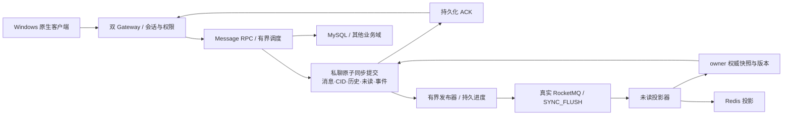

# TinyIMX 性能优化完整复盘：问题、改动、实验与取舍

本报告整理 2026-10-04 至 2026-10-27 的已有材料。2026-10-17 起的逐项问题账本、实验结果和源码差异另有完整索引；早期工作以当时的专项报告为准。报告先于本轮磁盘清理生成，清理后的容量与最终发布结果追加记录，历史失败不覆盖。

**本次最终采用 50,000 个认证在线用户、1,000 与 1,250 条/秒两档 300 秒正式结果。** 在 8 vCPU / 16 GiB、128 B 正文、原生私聊同步 WAL 和真实 MQ 下，两轮共 675,000 条计划消息全部闭环。ACK 平均分别为 9.258 / 13.290 ms，完整 P99 为 48.573 / 60.553 ms；正文吞吐约 128 / 160 KB/s。按用户最终范围停止继续加压与深度测试，详细口径见[50K容量报告](FINAL_CAPACITY_20261027.md)。

## 阅读和复现入口

- [所有问题的分卷索引](iteration-records/INDEX.md)：逐项保留问题 ID、当时状态、已执行动作、比较结果、证据和后续验证。
- [所有实验的目录索引](experiment-records/INDEX.md)：包括失败、准备、组件测试、完整业务和容量测试，保留实际状态，不把通用 PASS 自动解释为性能优化已采用。
- [原始机器问题账本](ISSUE_LEDGER_20261017.json)、[现有专项报告目录](iteration-records/DOCUMENTS.md)。
- [最终容量报告](FINAL_CAPACITY_20261027.md)、[最近测试失败的根因](FAILURE_ROOT_CAUSES_20261027.md)。
- 本轮清理前清单、源码补丁、工作树源码归档和 SHA 清单位于 `benchmark/results/consolidation-20261027/`。原始大体积实验保存在本机 E 盘证据区，发布包使用经过审查的精简证据副本。

历史文档里的“当前”“下一步”“运行中”代表其写作时点。本文的已验证配置和最新容量结果优先；原文保留，用于理解当时为何选择或否决一项改动。

## 1. 优化前后的架构到底发生了什么变化

复盘基线是 `a222c8fd2d90b40ce308aea58c3c625666284900`。早期私聊链是：Gateway 鉴权和关系检查 → Message RPC → MySQL 事务中写消息与 Outbox → 提交 → 后台领取并发布 RocketMQ → 未读投影。接收端 ACK 还会持久更新消息状态。它有明确可靠性责任，同时承担连接租借、SQL 往返、提交和后台派生的成本。

当前最高速率点使用**显式启用的原生私聊存储配置**：消息、CID 幂等、历史索引、未读真值和待发布事件在本地引擎中原子同步提交；后台发布器把持久事件送往真实 MQ，投影器读取 owner 权威快照更新 Redis；接收确认仍落盘。账号、关系、群和文件等业务继续使用 MySQL。它是私聊存储边界的实际变更，不能描述成原 MySQL 路径只调了几个参数。

仍然只有一个原生私聊数据所有者，依靠本地存储、所有权检查和恢复协议维护一致性。双 Gateway 不等于存储多副本高可用；单虚拟机容量实验也不构成主机故障自动切换证明。多副本、跨主机 fencing、物理清退和生产滚动升级须有各自的验收。

当前五个服务域是 **User、Social、Message、Group、File**。认证属于 User，关系属于 Social，消息及私聊会话能力属于 Message；不要改写成五个实际不存在的独立服务名称。

## 2. 分阶段的问题与处理

### 2.1 10 月 4—7 日：会话列表、群投递与业务边界

原会话列表最多 50 项，每项分别租借健康连接并 GET。批量方案改为一次租借和有界 Lua 读取，网络命令 100 → 2，租借 50 → 1；Redis 内部仍执行 50 次 GET。它保留错误类型、顺序、重复键、精确 int64、鉴权与回退语义，未用 Lua 浮点数处理大整数。同 ELF ABBA 在指定 10K 混合负载下取得会话页 P99 保守下降 80.46%。这个百分比属于该旧会话列表场景，不能转写成当前全部消息延迟改善。

群链路逐步检查 fanout、领取投递、完成回写、接收确认合并、路由批读与线程调度。部分组件减少 SQL 或平均耗时，但较大群的最慢全员送达仍不达原门槛。增加 Message RPC poller 的四轮实验没有稳定收益，否决。把“SQL 少了多少”与“用户实际快了多少”分开，是后续优化的基本准则。

证据：[会话未读 ABBA](CONVERSATION_UNREAD_BATCH_RESULT_20261006.md)、[当时全功能评估](CURRENT_PERFORMANCE_ASSESSMENT_20261006.md)、[群确认合并](GROUP_CONFIRM_BATCH128_20261006.md)、[RPC poller 负结果](MESSAGE_RPC_POLLERS_20261007.md)。

### 2.2 10 月 17—19 日：校准测试路径与固定源码对照

Windows 负载端、VMware 网卡、活跃流比例、客户端调度及服务器业务被拆开验证。早期 e1000 出现发送挂起，单独改 ARP、卸载参数、重启或换接口都没闭环；后来切换 VMXNET3，仍保存全活跃流超时和未发出的负结果。16 连接、16 KiB 的有限回显测得每方向约 1.02 Gbit/s 有效载荷，但回显不含认证、持久化和后台，不能作为 IM 消息容量。

固定 WuKongIM 提交 `a888f89533d0e7d1b2030e06504ca97f1ad891d4` 的源码和运行版本后，对照权限、本地提交、接收确认、频道调度及后台派生。差异不是简单的 C++ 对 Go、epoll 对其他网络库：Tiny 原链每消息多次 RPC/SQL/事务及外部 MQ/Redis，固定参考主要使用本地同步消息存储和进程内事件。源码审计因此改变了优化方向。

当时同 MID 的 474 个共同样本中，客户端入队到写调用平均约 0.0239 ms，Gateway 队列约 4.421 ms，持久化 RPC 约 6.810 ms，其中仓储约 5.276 ms、COMMIT 约 3.372 ms。仓储和提交嵌套于 RPC，不能重复求和。早期 500/s 的 4.84 ms 与 700/s、1,000/s 的参考属于不同工作点，不能混在一列计算差距。

证据：PERF-002、PERF-034、PERF-054/055/062/083/096/099/102/103；[实际源码差异与决策](SOURCE_DIFFERENCES_AND_DECISIONS_20261020.md)、[早期对照及消融](WUKONGIM_DIFFERENCE_ABLATIONS_20261019.md)。本轮遵照后续用户指示，停止新增参考项目实验，先完成 TinyIMX 自身容量。

### 2.3 10 月 20—21 日：原生存储接入、无外键和后台扫描

先验证本地存储组件，再接入真实 Message、独立 projector、双 Gateway 与实际 Windows 协议。接入中修复历史排序、分页 lookahead、隔离群 topic、恢复夹具来源和缓存零值断言等问题。组件的低提交延迟没有提前当成完整 IM 成绩。

原生存储保留同步 WAL、CID 冲突/重试、原 MySQL 排序规则、用户引用、历史/未读索引、确认、已读、事件隔离与恢复。原库非空历史必须显式迁移，拒绝把缺失数据路径自动创建成空库。单所有者和错误结构组合均有拒绝检查。

无外键改造按已确定工程政策执行：去掉业务和原生引用表的物理 FK/级联，保留主键、唯一键和索引；应用在整批写入前检查父记录及归属。父身份保留且 ID 不可变，禁用、解散、取消表达为状态变化。迁移先停写确认、孤儿审计，再逐项移除，可重入。真实迁移 28 → 0、仓储 45 项、原生 49 项及旧数据升级验证通过，随后九服务完整消息实验继续验证。原保护业务库未原地切换。

CPU 采样发现后台重复扫描/解码。事件索引、held 前置筛选、按空位限页被分开测试。索引和第一版 held 筛选的小幅 CPU 改善伴随尾延迟退化，未采纳；按实际可准入空位限页才减少未使用尾部工作，并进入后续配置。不能把这些相似名字写成同一项成功。

证据：PERF-105/110/113/118/122/132/146/149/155/169/173/180；[无外键改造](FK_FREE_CHANGE_20261020_R146.md)、[扫描消融](CPU_SCAN_ABLATION_20261020_R149.md)、[未读批量 RPC](NATIVE_UNREAD_BATCH_RPC_20261021_R180.md)。

### 2.4 10 月 21—24 日：真实 MQ、发布进度、异步续体与资源治理

MQ 的“批量函数”被追到线协议。旧 `AwaitBoundedAckBatch` 只是 N 次 SDK 调用；真正的多 entry ACK 还需要逐消息结果映射、代理支持与实际 broker 请求核验。真实持续收发探针验证请求数下降，同时保留无效回执的失败范围和恢复结果。探针发压节奏不合格的轮次没有写成稳态 1,000/s。

发布器原进度更新和前台提交争用同一持久资源。后续分别实现批进度、分片锁、独立有界进度 writer、无新写时避免无意义周期同步等候选。每项有状态机、停机和崩溃检查；暂停后台造成欠账的实验不接受为优化。积压预算扩大只能推迟触顶，不能替代持续排空能力。

网关异步工作从“释放等待线程”落实到会话 FIFO、截止时间、结果所有权、迟到结果和 Drain：RPC 等待可以释放工作线程，但同一会话的逻辑顺序继续保留。关系权限仍查权威数据，未用无失效的允许缓存换成绩。同步/异步真实业务结果逐项规范化比较后才进入负载测试。

资源维护同样留痕：旧隔离实验数据冷存档、实际独立恢复、原容器和数据保护；原 VM 正常关机/重启；用户分别批准 ext4 预留调至 2%、新增 80 GiB 后扩至 112 GiB 实验盘。上述动作不改变 8 vCPU / 16 GiB，也不算产品性能收益。

证据：PERF-218/235/243/255/260/316/360/397/438/443/530/608/620/754/771/783/832/852/863/881/900/909；[MQ ACK 协议](MQ_WIRE_ACK_BATCH_20261021_R218.md)、[发布/源码阶段总录](SOURCE_GAPS_AND_PUBLICATION_BATCH_20261022_R530.md)、[业务等价审查](BUSINESS_EQUIVALENCE_AND_SAFE_OPTIMIZATION_20261024_R863.md)。

### 2.5 10 月 25—26 日：减少重复稳定查询，补齐真实关键路径

稳定身份缓存仅复用已确认的不可变用户存在性和受限 ASCII CID 的 MySQL 权重。动态认证、好友/群权限、路由和 SessionEpoch 不由该缓存决定；未知字符、空格、Unicode 和未知用户保留 SQL 回退。冷引用登记合批在真实负载里不形成有效批次或没有收益，否决，不能因单元验证通过而开启。

阶段计时最初漏掉多输入批次，补齐成员 MID 与批次计时后，才看到 SQL 引用登记、批内准备、RPC 排队、引擎写队列、WAL 和业务续体的具体贡献。一个冷请求 ACK 69.7015 ms，其中 RPC 排队 35.379 ms、共享引用登记 16.361 ms、自身 WAL 0.847756 ms。说明慢请求不应统一解释为 fsync。

固定模 8 调度会阻塞无关用户；共享就绪队列在完整四轮仍使 P99 44.8565 → 49.3109 ms，否决。准备批上限 64 → 1 也使 P99 41.5622 → 54.2617 ms，否决。SST 分段写回 512 KiB 四轮 120 万条闭环后，CPU 仅改善约 0.218%、P99 恶化约 1.422%，未达到预设采用条件，关闭。源码看起来更合理并不保证端到端更快。

**提交快照回复是采用的优化。** 新创建消息原子提交已得到精确未读快照，ACK 前无需再做一次重复 Redis 读取；重试、旧协议和非法元数据保留原处理。四轮共 120 万条，OFF/ON 各 60 万条原始请求合并后，ACK 均值 7.1477 → 5.9735 ms、P99 26.4602 → 23.0262 ms，CPU 5.6200 → 5.5917 核。它达到延迟采用条件，同时保留真实后台投影。

证据：PERF-994/1001/1016/1206/1260/1296/1309/1432/1441/1472/1502/1545/1571/1598/1615/1616；[稳定身份缓存](IMMUTABLE_IDENTITY_CACHE_R608.md)、[逐层等待](LAYERED_LATENCY_CAUSES_20261026.md)、[最近源码与长时诊断](LATENCY_SOURCE_GAP_CURRENT_20261026.md)。

### 2.6 10 月 27 日：SDK 回调、LOCAL 兼容性与当前容量

固定 SDK 的空路由分支漏回调被实际复现：旧库回调 0 次，单实现文件修复后恰好 1 次 NotFound。59 个旧对象可精确重链旧库，仅重新编译一个实现文件，其余 58 个对象不变；双拓扑各 207 项完整业务、23 项 MCP、真实 C++ MQ 发布/丢 ACK/进程退出恢复通过。没有更换整套依赖来掩盖问题。

LOCAL 的 broker/proxy 同进程方案保留 `SYNC_FLUSH`，统一堆预算与 G1 参数后进入自身容量验证。它减少部署角色，不等于消息已做批量发送。

4 发布线程在 20K / 1,250/s / 300s 实际成功 352,120、拒绝 22,880。只读实际 WAL 的 2,017 个连续批次，反推待发布事件确实达到上限 **65,536**；闭库仍有 41,873 个待发布事件。资源通过，因此这次不是内存不足造成的假失败。

开启 MQ 批量发送后更差：375,000 请求中 179,388 成功、195,612 拒绝，156,507 次 SDK 批调用全部被严格回执校验拒绝。真实 LOCAL 代理给整个批次生成新 UID，而适配器要求能映射回输入消息 UID。18 条有限协议探针和只读 commitlog 逐条核验确认数据确实写入，回执身份不兼容造成重试及隔离。当前关闭该组合，并在三个真实入口提前拒绝，避免再次做已知无效负载。

随后只改原生发布线程 **4 → 8**，其余 CUD 九程序、SDK、LOCAL、held=64、进度批=16 均固定。真实 207 业务 + 23 MCP 通过后，1,250/s 的 375,000 条全部成功，后台 E/F/P 均清零、首次投影即一致、原 20 服务恢复。CPU 5.8581 → 5.6393 核属于单对观测，尚不写成可重复的固定节省百分比；控制组 22,880 个失败保留在分母，不能只比较成功延迟。

升至 2,000/s 后：计划 600,000，实际发出 436,722，333,042 完整成功、103,680 拒绝，163,278 因保护中止未发送。首次拒绝约 0.503 秒；约 218.035 秒根盘空闲低于固定保护线约 0.57 MiB 后中止。业务错误先于资源中止，须分别处理。已独立核验全部 333,042 条正文/CID/历史/未读/接收确认一致，仍有 42,772 个待发布事件，未将此轮接受为容量上限。

证据：PERF-1687/1695/1720/1723/1751/1758/1760/1764/1770—1779；[最新完整容量及边界](FINAL_CAPACITY_20261027.md)、`PERF1777-supervised-complete-business-r1`、`perf1751-p8-wire-users20k`、`own-capacity-2000-failure-r1778`。

## 3. 当前配置与未采用候选

以下状态依据实际通过的 P8 运行配置和二进制清单，不依据脏工作树里是否有某段新代码。

|项目|当前配置/结论|证据与意义|
|---|---|---|
|私聊存储|原生同步 WAL、原子消息/索引/事件提交|九程序来自经过验证的 CUD 版本；非原 SQL 路径的性能承诺|
|SQL 引用完整性|应用层检查，业务物理 FK 为零|父身份保留、ID 不可变；保留事务/唯一键/索引|
|稳定身份缓存|启用|仅不可变元数据，动态权限保持权威读取|
|权限异步与会话调度|经过完整图验证的配置|RPC 等待释放线程，逻辑 FIFO 与迟到结果保护保留|
|原生持久化批处理|启用，上限 64|有界就绪请求，不人为凑满；不是所有消息都在大批中|
|接收确认/后台批处理|启用|仍核对实际状态、逐项结果和停机恢复|
|提交未读快照回复|启用|四轮 120 万条延迟改善通过采用条件|
|精确键和需求限页|启用|作用与性能依赖组合；不据名称单独宣称固定收益|
|原生发布器|8 线程，held=64，进度批=16|P8 37.5 万条闭环；2,000/s 仍未通过|
|MQ|LOCAL，SYNC_FLUSH；ACK 批量启用|broker/proxy 为同一物理进程，资源统计去重|
|MQ 消息批量 SEND|关闭|LOCAL 批回执身份不兼容，入口拒绝已知无效组合|
|引用登记合批/guarded insert|关闭|真实负载无有效收益，或未达采用条件|
|共享 ready 调度、准备限额 1|关闭|四轮端到端尾延迟退化|
|集中物理写组、blocking wait|关闭|局部正确性不代表容量收益，按候选记录保存|
|能力感知领取、held 过滤|关闭|历史闭环/首次投影或收益条件不通过|
|SST 分段写回|关闭|四轮改善不满足预设阈值|
|Redis 成对读、事件编码复用|关闭|未证实正式收益或实验资源无效|
|新格式、批回执适配策略草稿|未启用、未发布|W 工作树存在未验证实现，不能混入已测产品|

主要产品 SHA：Gateway `04425bbd946f9b7a5189367e8a286bdc60f9a40c6e8ef015b029a40b44aafbbb`，Message `fc7f1cb0a2d216fd18d2ae146a98c7a2c1691a31a2270a9596ed3c68d742c752`，SDK `55f9fd2663e97c249e1f249a0a3247ea73482360e392f5198e0739ac1f9f9649`。完整九程序和实际开关保存在本轮 `tested-state.json`，冻结源码来源另有 1,293 文件/42 覆盖的原始清单。

## 4. 关键负结果：为什么没有采用

|候选/问题|实际结果|处理|
|---|---|---|
|接收确认合批减少 SQL|旧 UPDATE 减少约 81%，端到端 P99 37.0100 → 36.8175 ms|不按 SQL 减少比例宣传加速；后续原生确认另外验收|
|增加 RPC 空闲 poller|Message CPU 有下降，整机两对方向相反|保留原始四轮，不宣称整机收益|
|模糊“异步更快”|释放 OS 线程未解除同会话逻辑前驱|先修真实续体/超时/FIFO，再按负载验证|
|引用登记合批|真实负载不形成有效合并或未降低成本|关闭，转查每消息稳定身份 SQL|
|准备批 64 → 1|P99 恶化约 30.56%|关闭，避免把引擎执行变短误判为 RPC 整体变快|
|共享有界 ready 队列|四轮 P99 恶化约 9.93%|否决，不因修复局部公平问题强行采用|
|SST 512 KiB 写回|CPU 仅下降约 0.218%，P99 恶化约 1.422%|否决，不推断已解决长时 I/O 故障|
|能力感知领取|P99 改善但首次投影未通过|否决，业务完整性优先|
|暂停后台或放大事件预算|欠账或更晚触顶|不计入可持续容量|
|LOCAL 批 SEND|所有实际批回执被拒，重试后进入隔离|默认关闭，增加实际拓扑兼容门槛|
|207 业务 + 23 MCP 当批量证明|实际批调用数为零|保留业务通过结论，撤销批量分支已覆盖的推断|

## 5. 测试样例与真实产品问题必须分开

原生 Windows 客户端逐消息保存计划、入队、写入、ACK、投递和失败，校验 uint64 身份、正文、CID/MID、收件归属。接收 ACK 在实际网络写入后记账；中止写出未发送数，避免旧强杀控制器丢失完整分母。64K 连接只是当前工具边界，未经过实验前不称为服务器上限。

测试控制器修复包括：磁盘设备名变动改为 UUID + SCSI + 实际根挂载识别；实际执行的 Java 断言与离线资格文件统一；LOCAL broker/proxy 进程统计去重；缺少结束时钟或首次投影文件时生成失败结果而不是分析器再次崩溃；原服务恢复独立于实验盘读取失败。每项原失败、修复和验证保留。

协议诊断器也曾出错：假定所有批次 queue=0、使用 Java 8 不支持的接口、把 commitlog CRC31 当成完整 CRC32。修正后使用**原来同一批 18 条数据**只读重核，没有重新发一批来掩盖失败。

宿主与客户机时钟不直接相减；跨进程阶段用共同 MID 和已校准时间映射。P99 不平均、不相加；嵌套 RPC/仓储/WAL 不重复计费；采样诊断和关闭追踪的正式成绩分开。根网络命名空间 TCP 统计不代表所有 Docker 网络栈。

## 6. 容量口径、QPS 与吞吐量

消息容量采用**完整成功业务消息/秒**：客户端收到持久化 ACK，目标客户端收到合法消息并确认，最终持久状态、CID/历史/未读索引、真实 MQ 和首次投影一致；结束无未发布、隔离和待确认欠账。内部 RPC 数、SQL QPS、broker 请求数不与业务消息 QPS 混算。

20K / 1,250/s / 128 B 的单向应用正文吞吐为 `1250 × 128 = 160000 B/s`，约 **0.153 MiB/s / 1.28 Mbit/s**。该数只算消息正文，TCP、JSON/Protobuf、认证心跳、ACK、RPC、MQ 与存储写入额外开销另列。需要 4 KiB、16 KiB 专项才能测大报文有效吞吐，不能用小消息 QPS 冒充带宽上限。

20K 用户在 1,250/s 时平均每用户每分钟 3.75 条，全部发送者在窗口内参与，不表示每时刻 100% 用户同时发送。最大在线连接、最大可持续速率、低延迟推荐工作点、大报文吞吐、恢复速度分别报告。

计划发压 300 秒但在 218 秒中止的失败轮，应同时报告计划分母、实际发送、完整成功、拒绝、未发和观察区间；不能将短窗口成功数除以任意时长包装成可持续 QPS。

## 7. 清理的保留边界与执行次序

本轮先生成问题/实验/文档完整索引、源码补丁和归档清单，再回收空间。保留：全部迭代记录、采用与否决实验结果、源码改动、复现工具、合格产品/SDK 清单、故障与恢复证明；原业务库和 binlog、九个明确保留库、现有容器/镜像/快照继续保护。

可回收对象优先为已结束测试的普通重复文本日志、可再生缓存、已验证归档的重复解包副本和不再需要的大体积压测消息载荷。每批记录精确路径、大小、归档 SHA、实际独立恢复核验、源未变化检查、回收结果。仍有 E/F/P 欠账的失败实验保留可恢复原始存储，不能当普通垃圾直接删除。

磁盘清理不使用“可用空间不够”作为放宽正确性或资源门槛的理由。短期普通空闲充足但跨越实验保护线时，先核对写入增长来源；用足够安全余量启动下一轮，避免高频保护中止。

## 8. 清理后的最终验收与发布

按已测试的 8 发布线程配置先确认 1,250/s 的可重复性，再在成功点和失败点之间缩小速率区间；独立扩大连接数，记录全部用户参与、客户端调度和资源；增加 4/16 KiB 负载及至少 30 分钟平台测试，保存每分钟 P99、CPU、后台积压斜率和全部错误。对故障恢复另外验证，不把平稳负载全通过当成高可用证明。

最终清理和测试结果追加至[最终容量报告](FINAL_CAPACITY_20261027.md)，本报告继续保留问题演进。发布从经过验证的冻结源码和明确允许的修复构建，逐文件排除未启用候选、密钥、私有配置、实验原始大数据和二进制；项目介绍突出产品能力和实际通过的指标。GitHub、Gitee、GitLab 的分支、提交 SHA、推送和远端核对逐项留档，失败的仓库同步单独处理。

## 9. 最新范围：固定 50K，集中提高实际业务容量

用户将后续范围明确为 **50,000 名认证在线用户**。停止扩至64K/120K和新增来源IP方向，旧20K优质成绩继续作为历史记录，最终推荐指标必须使用新的50K实测。50K/500条每秒时平均每用户每分钟0.6条，15秒心跳约3333次每秒；业务消息QPS与心跳/RPC请求数分别报告。当前双Gateway均衡放置成对用户，配对消息为同Gateway路径；跨Gateway功能另由完整业务套件验证，不能将该负载描述成全部跨Gateway的容量。

此前大用户负载的两次失败均在发业务消息前发生：Windows49152端口禁止独占绑定10013，以及49787预检查后被其他应用占用10048。它们属于负载端建连失败，业务发送均0。共享端口原型虽然有限回显通过，却未通过两项真实监听端口隔离测试，已否决，没有部署或修改系统网络设置。

新R1788负载端保留原测量流程与严格SO_EXCLUSIVEADDRUSE：认证前实际预约全部用户和备用端口，逐个交接；交接竞态只能使用预先预约的有限备用，保留每次错误，不重试认证或业务消息。真实50,512个独占预约、普通监听不受覆盖、交接回显和竞态替换均通过。正式50K认证和持续负载仍须实际验收，预约成功不作为服务器容量结论。

另发现外层恢复脚本仍持旧20点map，旧P22主动停止后独立恢复了原20服务，再修复全部6个嵌套映射。资格检查扩展到外层恢复、实际CLI和全部新档位：636个Ubuntu程序、322项Java、265项就绪检查通过。新只读校验器单独构建，重读旧375000条消息逐字段相同、存储SHA不变；50K账号的最后10K部分块也执行真实SQL验证。

清理方面，原43个日志批之后又归档3份停止测试普通日志，实际恢复校验后回收约3.29MiB。全部4518个容器配置/镜像、九个保护库、原业务与binlog保留。P31为50K/500条每秒/300秒，先建立此规模的完整成功基线，再提高消息速率，单独测4/16KiB正文吞吐及30分钟稳定平台。当前不启动任何新的开源对照。

对应问题与结果：PERF-1784—1790；详细机器记录见问题台账及 fixed-50k-preparation-r1789、exclusive-50k-kernel-qualification-r1788、fixed-50k-seed-r1789、root-garbage-r1790。

## 10. 固定50K后的最终结果与发布收尾

50K认证在线的P33与P54分别完整完成300000与375000条消息，零负ACK、超时、内容错误、原始重复和未调度。逐条只读核验持久正文、CID/MID、历史、未读和接收确认，首次投影准确，后台待发布/隔离/待确认均为0，原服务恢复。

P34旧负载端在宿主机内存保护处收尾，实际发送356022条均成功持久确认。新共享心跳调度以一个到期堆、一个定时器和64有界回复线程替代逐账号任务，消息与计时循环不变；P54正式375000条全部闭合，客户端峰值从1449.055MiB降至963.016MiB。本轮未改变服务端程序和持久化语义。

最终报告仅使用用户指定的50K/1000与1250条每秒两档300秒。发送QPS为1000和1250；含最后收尾的完整完成QPS为999.977529和1249.946351；128B正文约128000和160000B/s，即1.024和1.280Mbit/s。完整P99保留首分钟；两档客户端心跳版本区别单独说明。更高速率、大报文和30分钟测试在用户本次停止指令后不再执行。

产品介绍配合真实Qt界面，展示消息状态、群与文件权限、独立文件通道、Ollama及8个只读MCP工具。产品页与报告在1416和516宽度完成离线渲染，图片、标签、键盘和边界核验通过。已准备但未采用的16线程/capability-take组合、LOCAL批SEND草案及新的原生引用格式不进入此次发布配置。

清理仅处理普通标准输出日志：原Nginx先停止、归档E盘并实际恢复核验后才回收约1.21GiB；原20服务恢复，4588容器配置/镜像、原SQL及九个受保护库保持。全部历史迭代、比较结果、源代码与消息证据按原档案保留。GitLab依用户最终要求暂缓，发布目标为GitHub与Gitee。
