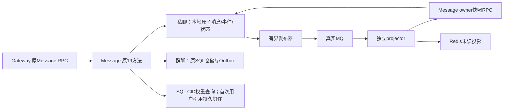

# TinyIMX 与固定 WuKongIM：源码差异、实测取舍、未完成项

**当前状态以[最新逐函数审计和R135完整实测](SOURCE_GAP_AUDIT_20261020_R132.md)为准。** native已实际接入完整双Gateway/Message/projector，并通过42000客户端、存储、broker和Redis核对；ACK P99 18.8822ms，VM 5.441忙核，仍未达到最终对标目标。下文保留各历史轮次的当时状态，“尚未接入”等旧描述不能当成当前待办。

当前完整系统仍未追平。旧轮次已经做过源码审计，但候选开关、组件成绩、当前运行版本和待集成工作散落在历史记录中，不能形成完成证明。本页只给可复核的事实与下一验证。

## 当前差距

固定 WuKongIM 提交 `a888f89533d0e7d1b2030e06504ca97f1ad891d4`；Tiny 原始复盘提交 `a222c8fd2d90b40ce308aea58c3c625666284900`，完整实测使用 R12 候选程序。

既有 10000 认证连接、全部参与、128 B、700 条/s、60 s：Tiny R12 OFF/ON/ON/OFF 共 168000 条完整成功，ACK P99 为 42.7668 / 38.5450 / 41.1990 / 44.5990 ms，VM 平均忙核 5.87–5.93；固定 Peer 独立 QPC 参考轮 ACK P99 12.5513 ms、投递 P99 13.504829 ms、平均忙核 0.951743。不是本轮新测，也不是服务器最大容量。早期 500/s 的 4.8371 ms 是另一工作点，不与 700/s 混排。

## 逐源码差异与消融结论

|问题ID|可定位代码|具体实现差异|已有比较结果及边界|
|---|---|---|---|
|PERF-099|[WuKongIM](<WORKSPACE>/benchmark/results/peer-20261017/PERF034-actual-r11-source-differences-r98/source/peer/internal/service/permission.go:216) / [TinyIMX实际参测源](<WORKSPACE>/benchmark/results/peer-20261017/PERF034-actual-r11-source-differences-r98/source/tiny/gateway/GatewayServer.cpp:5742)|Peer本地节点直接allowSend，远端所有者才RPC；Tiny原路径每条RPC后执行一个双向好友关系SELECT。R11新增可选进程内有界端口，仍每条查权威SQL，未实现Peer的本地KV/权限缓存。|Four same-R11 runs OFF/ON/ON/OFF, 168000/168000. Paired ACK P99 reductions18.3749% and5.2435%; delivery17.9787% and5.6488%; VM CPU3.1212% and1.6791%. Every run verifies exact42000 permission SELECT placement and all pipeline/order/SQL/cache/shutdown gates. Two runs per mode do not establish a confidence interval or fixed18% gain.|
|PERF-055, PERF-096|[WuKongIM](<WORKSPACE>/benchmark/results/peer-20261017/PERF034-actual-r11-source-differences-r98/source/peer/pkg/wkdb/message.go:17) / [TinyIMX实际参测源](<WORKSPACE>/benchmark/results/peer-20261017/PERF034-actual-r11-source-differences-r98/source/tiny/services/message/repository/MessageRepositoryAdapter.cpp:276)|Peer写本地消息键与频道序号，等待同步Commit，再更新序号缓存。Tiny经Message RPC借MySQL连接/PING、CID预查、BEGIN+INSERT+完整身份回读、Outbox INSERT、COMMIT。BEGIN/INSERT/回读已合包，但不是合并为一条SQL。|Tiny474同MID：Persist RPC均6.810276ms，内含仓储5.276293ms与COMMIT3.371970ms。Peer新轮685样本persist0.740763ms，内含db_append0.386126ms；不同样本不能逐项相减或相加P99。R90原生多行SQL仅隔离资源验证，未集成此次Message ELF。|
|PERF-054|[WuKongIM](<WORKSPACE>/benchmark/results/peer-20261017/PERF034-actual-r11-source-differences-r98/source/peer/internal/user/handler/event_recvack.go:16) / [TinyIMX实际参测源](<WORKSPACE>/benchmark/results/peer-20261017/PERF034-actual-r11-source-differences-r98/source/tiny/services/message/repository/MessageRepositoryAdapter.cpp:1368)|Peer普通Recvack移除该连接重试项；SyncOnce/master另有异步会话位置更新。Tiny普通接收ACK通过owner+状态谓词持久更新MySQL消息，和新消息/Outbox共用数据库资源。|当前OFF的SQL观测窗口接收确认UPDATE41996次、平均3.787339ms；窗口边缘计数不是全量成功分母，最终SQL另核对42000。旧5ms收集合批少81.33%UPDATE，但端到端ACK P99仅37.0100→36.8175ms，未证明稳定收益。|
|PERF-062, PERF-083|[WuKongIM](<WORKSPACE>/benchmark/results/peer-20261017/PERF034-actual-r11-source-differences-r98/source/peer/internal/channel/handler/event_persist.go:108) / [TinyIMX实际参测源](<WORKSPACE>/benchmark/results/peer-20261017/PERF034-actual-r11-source-differences-r98/source/tiny/services/outbox/OutboxRelay.cpp:366)|Peer存储成功后投递进程内频道事件。Tiny需领取/续租Outbox、发布MQ、SQL回写、broker/proxy、SQL SUM/COUNT未读真值、Redis快照与MQ确认；当前AckBatch为逐条SDK asyncAck，并非一次原生多receipt请求。|当前OFF整VM6.104434核，MySQL2.263453核、broker+proxy1.191013核，后两部分合计约56.59%。这证明工作量占用，不直接证明每条ACK的延迟份额。旧暂停后台有约999事件/s欠账，不算产品加速；批快照ABBA无稳定收益。|
|PERF-087, PERF-093, PERF-094|[WuKongIM](<WORKSPACE>/benchmark/results/peer-20261017/PERF034-actual-r11-source-differences-r98/source/peer/internal/channel/event/handler.go:62) / [TinyIMX实际参测源](<WORKSPACE>/benchmark/results/peer-20261017/PERF034-actual-r11-source-differences-r98/source/tiny/gateway/business/BusinessExecutor.cpp:1049)|Peer processing标记覆盖同步OnEvent，onSend同样依次permission/persist/sendack。Tiny用户对FIFO包住更长RPC/存储链，hash stripe还可能阻塞无关键。换事件队列或释放OS线程并未自动消除前驱工作的逻辑顺序约束。|实际Peer新轮99.3619%消息为单消息执行。Tiny旧ready4使服务新增排队均2.8261ms、上游Gateway均4.4212→9.0402ms；正式两方向尾延迟均变差，默认关闭。完整键隔离首对ACK44.5409→45.0597ms，也没有收益。|

|PERF-103|[Peer onSend](<WORKSPACE>/benchmark/results/peer-20261017/PERF034-actual-r11-source-differences-r98/source/peer/internal/channel/handler/event_onsend.go:17) / [Tiny 最终 ACK 前置工作](<WORKSPACE>/benchmark/results/peer-20261017/PERF034-actual-r11-source-differences-r98/source/tiny/gateway/GatewayServer.cpp:6403)|Peer 权限/持久化后生成 sendack，投递由事件推进；Tiny 最终 ACK 还包含未读快照与接收提交/状态字段。|尚未对该边界做改变；不能提前回旧 ACK 充作性能改善。Peer 投递 P99 同样更低，因此该语义差异也不能解释全部性能差距。|

## 为什么目前仍没有优化到位

1. R12 合并 Outbox INSERT 与 COMMIT 的一次客户端协议请求，只减少一个跨边界往返；没有删除事务、redo/binlog、接收确认写入和后台派生。完整 ABBA 两方向 ACK P99 只改善 9.87% / 7.62%，不足以追平约三倍差距。
2. 旧异步、ready 合批和散列/精确队列等候选已有负结果。它们释放线程或变更调度，却没有减少同用户对前驱的工作；不能重复把这些机制列为已获得的收益。
3. 新本地存储尚未用于完整 Message 服务。原启动入口仍构造 SQL 仓储。因此它的组件改善根本没有进入当前端到端结果。
4. 新存储不是把数据库类替换即可：旧未读读者和 OutboxRelay 只认识 SQL，新消息仅存本地会使后台漏处理；旧 CID 使用 MySQL 排序规则，原用户外键约束也不会自动迁移。跳过这些兼容工作属于语义缺失，不能据此宣布加速。
5. R104 仓储组件改善是真实但范围有限。当前新增 SQL CID 权重查询、索引、发布与远程未读读取后必须重新测；旧的 1.67–1.76 ms 提交 P99 不代表当前客户端 ACK。

## 同请求阶段观测：已经知道什么

旧 R10 OFF 诊断中 474 个共同 MID 的均值：客户端入队到写调用 0.023866 ms；Gateway 业务队列 4.42122 ms；权限 1.70011 ms；Persist RPC 6.81028 ms，内含仓储 5.27629 ms、COMMIT 3.37197 ms；路由 0.35026 ms、未读 0.60817 ms。数据是旧共同样本，不能冒充当前版本。仓储/COMMIT 嵌套于 RPC，不能重复求和；也不能把不同阶段 P99 相加。

该观测不支持把主要差距归咎于 Windows 发送排队。它支持优先审查服务端逻辑队列和持久化链，但尚未给出当前版本每条消息完整关键路径的因果占比。下一轮必须在同一 MID 上对齐客户端、Gateway、RPC、SQL/引擎与后台阶段，保持低采样诊断轮与不采样性能轮分开。

## 当前候选必须继续验证的工作

|问题ID|已落实或已发现|下一验证|
|---|---|---|
|PERF-105.3|有界 native 发布器代码：成功后记录进度，退避/隔离保留原事件，显式重入队，周期/停机同步 WAL|普通与 ASan/UBSan、实际进程终止恢复；随后用真实 MQ、Redis 和 owner 网络快照验证排空，不能用测试 publisher 代替 broker|
|PERF-105.5|新 CID 身份桥每条仍访问真实 SQL，版本/排序规则被钉住|将其成本计入新版本；升级/迁移必须重验，不能称为纯本地链路|
|PERF-105.6|format3 为后续用户生命周期增加原子 actor 索引；已有输入/当前用户存在性验证|补持久引用协调、owner/MID 与旧历史迁移；单次 EXISTS 不等于原外键生命周期|
|PERF-108|MQ SDK 旧依赖与新快照 RPC 在同一程序加载；源码原有进程隔离注释需核对|实际 ELF 动态符号检查未发现 gRPC/protobuf 核心同名导出交集，不断言 ABI 冲突；继续实际同时调用 MQ/RPC、投影与停机验证|
|PERF-034|所有旧负结果与固定源/二进制有记录|完成运行组合和完整语义后，原配置同负载 ABBA + 固定 Peer，再测容量和长稳；本目标保持未完成|

附加源码位置：

- [examples/message_service_demo.cpp](<WORKSPACE>/examples/message_service_demo.cpp:136)
- [services/message/local/MySqlLegacyIdentity.cpp](<WORKSPACE>/services/message/local/MySqlLegacyIdentity.cpp:31)
- [services/message/local/LocalPrivateStore.cpp](<WORKSPACE>/services/message/local/LocalPrivateStore.cpp:137)
- [services/message/local/LocalEventRelay.cpp](<WORKSPACE>/services/message/local/LocalEventRelay.cpp:61)
- [cmake/TinyIMXRocketMQ.cmake](<WORKSPACE>/cmake/TinyIMXRocketMQ.cmake:75)
- [cmake/TinyIMXLocalStore.cmake](<WORKSPACE>/cmake/TinyIMXLocalStore.cmake:27)

机器入口：`benchmark/results/peer-20261017/PERF034-source-review-current-r107-r1/result.json`。该脚本重新校验固定源码 SHA 与具体行锚；没有把引用代码的存在当成优化已经部署。

## R107 当前执行结果（覆盖上表中的当时待测状态）

- 发布器候选已完成普通/ASan+UBSan各111检查，以及4次实际进程终止恢复。故障 publisher 使用同步测试日志，未冒充真实 broker 故障。
- 新隔离命名空间的真实MQ/Redis/owner RPC联动32检查通过：12消息/13事件完成发布、消费、投影、已读清零、缓存重建、owner停止后的失败与停机。该测试在一个隔离C++进程中经loopback网络调用owner；尚未部署独立Message/projector和双Gateway，不是完整性能试验。
- R8的发布扫描竞态失败、R7重启后容器旧IP失效、R1临时Redis自动移除采集竞态均保存；后者原始RAM日志已缺失，未算完整通过。新命名空间R2重跑并独立核验E归档。所有原1838容器、20运行服务、十程序SHA、原业务与九保留库保持，binlog1–93全部保留。
- 原20服务仍使用R12 SQL仓储；format3本地候选默认未接入。用户生命周期、旧历史迁移、分进程/双网关合同、当前同MID分解与完整ABBA仍未完成，当前没有新的完整IM性能成绩。
- PERF-108运行验证通过；PERF-109已追到固定SDK空metric设置的启动解析日志，未将其当作业务失败或性能主因，也未改冻结SDK。

本轮权威入口：`PERF107-source-and-publication-followthrough-r3/result.json`；真实后台原始日志归档SHA `edc0499e3b8b8956a1036fc102541f151b1f75ad3c3c6c792c08fa0fc3b30f75`。

## R110：实际 Message 主程序与独立 projector 已完成接入验证

候选已从组件推进到真实服务入口，仍为显式 opt-in；原20服务/十程序未替换。原19个Message方法保持，快照服务共用Message端口；原群聊仍走SQL端口。新私聊消息不再写SQL消息/Outbox，而以本地原子批次持久化消息、事件与状态；这是存储架构候选，不能称作原SQL路径的微调。

持久引用在本地新消息提交前建立，用户删除被FK阻止；新消息未提交而留下的孤立引用只在单所有者启动时按本地原子actor索引清理。已登记数据缺失时拒绝创建空替代库，错误路径/主机/配置和第二所有者拒绝；SQL owner会话丢失后停止新写。它依赖单本地文件系统所有者，不是分布式fencing方案。管理员改用户ID在候选中明确RESTRICT，强于旧SQL的CASCADE；旧非空SQL私聊历史须显式迁移，未默认推广。

实测：引用普通/ASan+UBSan各33检查、2次真实pin-before-local-commit/local-sync后SIGKILL恢复通过。实际Message和projector为不同PID；31新写RPC检查、28重启幂等/历史/状态检查通过，14事件全部投影并ACK，处理/ACK错误0；Main停机发布队列0，第二次启动没有新消息或重复发布。独立重建进程将错误缓存恢复为0/4/4，关闭native启动会拒绝读取空SQL历史。

R1验证失败是缓存断言错误：产品以删除键表示未读0，脚本却要求字符串0并用strip丢失首项。日志已证明14/14处理；没有把失败改写为成功。R2换新schema/topic、严格JSON校验后完整重跑通过。复用构建归档的旧fixture条目混入问题另记PERF-111，恢复现按逐个实际文件清单，归档排除继承fixture并记录当前来源。

当前仍没有双Gateway/有效群权限全协议门槛和新完整IM性能结果。后续必须计入保留的SQL CID查询与首次用户pin成本，再做同MID分解、无诊断ABBA、容量与长稳。旧R104组件P99不能代表该版本。

权威结果：`PERF110-main-lifetime-followthrough-r3/result.json`；实际独立进程归档SHA `042fba9d82a880d1ca608269a9de74e0eff3d92242d457169910e66c10056b89`。

## R113/R114：真实网关接入已执行，排序修复与额外边界

详见 [当前逐源码差距与闭环](CURRENT_SOURCE_GAP_REVIEW_20261020_R113.md)。R16修复历史升序/lookahead；R6私聊wire与114条闭库全量核对通过，有效Group权限/投递通过。跨网关替换是心跳触发（PERF-116），Group域固定topic导致隔离域事件失败（PERF-117）待修复。没有新的完整ABBA/容量成绩；此前组件数字仍不代表当前客户端P99。
