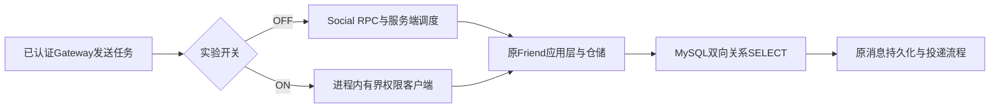

# 固定开源实现差异驱动的消融记录

最新源码与当前取舍见 [SOURCE_DIFFERENCES_AND_DECISIONS_20261020.md](SOURCE_DIFFERENCES_AND_DECISIONS_20261020.md)。R107发布器111×2、真实故障4次与真实MQ/RPC/Redis32检查通过；原完整IM仍为R12 SQL，尚未追平。以下章节保留各历史轮次原状态。

<!-- CURRENT_APPLICATION_R105_BEGIN -->
## R105：应用兼容、批确认崩溃恢复与跨进程快照已通过；正式IM仍使用R12

当前没有新的完整IM性能结果。上轮R104的本地仓储数字不包含本轮新增的SQL身份权重查询、K/R索引以及真实事件发布/投影链，不能作为本版本性能。新候选继续默认OFF，十个现有运行程序字节保持。

|具体问题|本轮已执行的代码/验证|结果与下一项|
|---|---|---|
|105.1 私聊完整端口|LocalMessageRepositoryAdapter覆盖私聊写/身份解析/历史/会话/离线/批ACK，群聊转交原端口；原应用与真实Message RPC验证|端口/应用通过；启动组合、有效群权限和双Gateway全协议仍待测|
|105.2 未读权威源|同一读快照的对话/全用户计数、零计数历史入站联系人；追加独立服务与有界客户端，独立projector编译支持显式owner目标|实际网络18项通过，失败/错误响应/超时/关闭不回退SQL；真实MQ/Redis重建与排空未执行|
|105.4 批确认|整批原授权后在有序接收者锁下重读，单同步WriteBatch，拒绝混合foreign/missing/duplicate不部分修改|普通/ASan+UBSan应用各86检查；4个实际批同步前/后SIGKILL，3条状态整体恢复，CID重试幂等|
|105.5 CID旧语义|MySQL8.0.40+unicode_ci/PAD SPACE权威只读键，版本写入format2所有权标识；9组大小写/重音/空格/展开/NUL真实SQL对照|通过；保留该SQL查询成本。WEIGHT_STRING是内部调试函数，未当成跨版本稳定格式，升级须重新校验/迁移|
|105.6 边界与身份|65535-byte TEXT、65536/非法UTF8失败、先既有CID冲突再新body超限；验证bootstrap以外已登记SQL用户|通过这些输入/当前存在性；原外键全生命周期、用户删除/改ID、多owner/MID与旧历史迁移仍开放|
|105.3 后台事件|原事件格式、待发布持久化与progress WAL保留|有界native发布器、重试/毒事件与周期sync未实现；不得把保留后台进程当作完成派生工作|

R2重做原owner两锁模式普通/消毒检查与8次消息SIGKILL，另执行两组真实SQL应用和4次批ACK SIGKILL。资源库仅增加20消息/事件，从8000/8000到8020/8020；拒绝无写入。原业务、九个指定库、全部92binlog、1838容器和十ELF保持。底层RocksDB/旧core/SQL驱动未消毒重编，未宣称全依赖消毒。

R5：真实loopback18、协议155、原应用64通过；新增projector构建成功。R6用实际protoc33.4生成旧/新完整描述符，移除显式追加的5个消息类型与1个独立服务后，原common/message描述符逐字节相同，覆盖原全部字段/枚举/选项/方法类型与顺序。

失败也保留：R1旧测试目录只接受104前缀而在测试前拒绝105；R3模板语法在SSH前失败；R4网络通过但旧协议测试要求17而封存R12已19。PERF-106保存旧源码证明，门槛改为逐一覆盖原19方法，未放宽到最少数量。修正后回归通过。

权威入口：`PERF105-integration-followthrough-r7/result.json`、`PERF105-application-qualification-r2/result.json`、`PERF105-application-qualification-r5/result.json`、`PERF105-exact-descriptor-compatibility-r6/result.json`。下一步实现发布与Message启动/停机组合、用户引用生命周期，完成真实MQ/Redis/双网关合同后再做完整同负载ABBA和Peer对照。
<!-- CURRENT_APPLICATION_R105_END -->

<!-- CURRENT_NATIVE_R104_BEGIN -->
## R104：对照本地持久化机制的C++候选、真实恢复与组件A/B；完整IM仍未追平

当前实际IM仍是R12 SQL持久化，不能把以下仓储结果冒充客户端ACK指标。固定Peer源码和最新实际SQL/RPC差异见下方六行表；本轮新增原子本地消息/事件/确认存储，是可选架构实验，不是复制Go代码后即获得同等完整业务。

### 先保存负结果，再按具体源码差异消融

R5首次SQL/native/native/SQL，16000操作：Native均值降低约36.8%～49.5%，但反向两配对P99恶化42.64%/4.54%。未据此推广。新候选原来把CID/接收者/对话三个键散列到64把锁，产生无关用户碰撞；改为有界身份注册表中的精确用户锁，发送方保证跨接收者CID冲突，双方保证会话序，接收者保证计数/ACK/已读。默认OFF。这是新存储内部锁，不是旧Gateway完整键候选；旧完整系统负结果仍保持，不将本轮组件收益归因给旧Gateway修复。

R6同ELF原分片/精确/精确/原分片，两种负载16000操作，双方打开相同计时：

|范围|原分片P99 ms|精确用户P99 ms|反向精确P99 ms|反向原分片P99 ms|
|---|---:|---:|---:|---:|
|消息+事件同步提交|4.401921|1.700084|1.754039|4.480718|
|上述提交+持久接收确认|5.113839|3.036734|3.398804|5.061969|

发送场景平均锁等待0.682616→0.243423ms，engine Write调用0.624468→0.625157ms；反向0.656842→0.242324ms、Write0.579447→0.637592ms。说明该消融主要减少锁等待，不声称磁盘fsync变快。Write包含引擎排队/WAL/同步；同MID最慢20条分解保存在逐条证据，禁止相加不同P99。两组ACK确认负载的尾延迟亦改善，但热用户/扇入扇出尚未验证。

### 修正锁后，与SQL重新匹配初始历史做A/B/B/A

R7同一资源测试ELF、8线程/128B/每臂2000；两侧先各有4000条相同用户对/数量/消息内容与确认状态的历史，native额外8000预填操作独立保存且不计入性能。双方计时关闭、SQL现有最佳受控配置保持强持久化与FULL binlog；原20服务待机。SQL具有binlog/FK，native使用本地同步WAL，架构并非完全等价。

|仓储范围|SQL A P99 ms|Native B P99 ms|Native C P99 ms|SQL D P99 ms|
|---|---:|---:|---:|---:|
|消息+事件同步提交|4.303399|1.665751|1.758078|3.444046|
|上述提交+持久接收确认|5.406038|3.069144|3.170686|5.530745|

两方向消息提交P99下降61.29%/48.95%，包含接收确认下降43.23%/42.67%。这是组件操作，不含客户端/Gateway/权限/RPC/MQ发布与Redis投影。共48000计时操作和8000预填操作原样保留，未宣称最大IM吞吐或统计置信。R6两锁模式各普通/ASan+UBSan44项，共176项owner合同及8个真实SIGSTOP→SIGKILL→重开恢复通过；RocksDB和旧核心未消毒重编，不冒充全依赖消毒测试。

### 为什么仍未直接接入完整系统：逐源码核实的PERF-105

1. 服务仍构造SQL MessageRepositoryAdapter，新类未实现完整端口；单条接收确认不替代现有整批授权/原子确认。
2. 未读投影仍直接COUNT SQL历史；新消息仅写本地后会被旧读者漏掉。必须接入真实owner快照并验证Redis重建，不能只保留投影进程外观。
3. 旧OutboxRelay仅领取/更新SQL，native事件尚无后台发布；全部组件实验明确保留待发布事件。需要有界发布、毒事件/故障重放与周期进度同步，完成MQ/cache对账。
4. 实际CID是utf8mb4_unicode_ci唯一索引；native原始字节键不复现大小写/重音/PAD SPACE等价。ASCII压测不能覆盖这个身份边界。
5. 实际TEXT65535bytes、用户外键UPDATE CASCADE/DELETE RESTRICT、全局自增，和新8MiB/静态用户表/本地MID租段不同；本机UTC相同。需要明确迁移/身份生命周期/多owner策略。
6. 以上接入后才做原Windows原生客户端完整语义、全部后台排空、同负载四轮与固定Peer对照；不能早发ACK、关后台或忽略旧历史来宣称追平。

结果入口：`PERF104-source-and-decision-r5/result.json`（原负结果）、`PERF104-source-and-decision-r6/result.json`（锁/同步同MID消融）、`PERF104-source-and-decision-r7/result.json`（修正后SQL对照）、`PERF105-local-store-integration-audit-r1/result.json`（实际依赖/兼容性和下一验证）。原日志、全源码/对象/参数、物理恢复文件均逐SHA/大小独立E归档；两次失败（SDK接口、故障工具缓冲漏读）保留且未记通过。全部1838容器、原业务/九库、92个binlog及十个服务ELF保持。
<!-- CURRENT_NATIVE_R104_END -->

<!-- CURRENT_FULL168K_R102_BEGIN -->
## 当前结果与源码差距：完整16.8万条权限ABBA，持久化候选完整四轮对照已完成

**仍未追平。** 当前实际参测R11与固定WuKongIM的逐文件SHA/函数原文保持封存，最新结论入口：`benchmark/results/peer-20261017/PERF034-source-gap-followthrough-r102/result.json`。下方各历史轮次的“待测”状态只代表当时；当前状态以本节与机器结果为准。

<!-- PERF102_FULL_ABBA_BEGIN -->
### R12完整四轮最终取舍（同程序，仅切换Outbox/COMMIT请求合并）

|轮次|完整成功|ACK P99 ms|计划→投递P99 ms|整VM平均忙核|
|---|---:|---:|---:|---:|
|r103 OFF|42000/42000|42.7668|42.959343|5.865834|
|r104 ON|42000/42000|38.5450|38.794743|5.899808|
|r105 ON|42000/42000|41.1990|41.433558|5.879111|
|r106 OFF|42000/42000|44.5990|44.672386|5.927551|
|固定Peer独立QPC参考|42000/42000|12.5513|13.504829|0.951743|

r103 OFF对r104 ON：ACK P99降低9.87%，投递P99降低9.69%，VM忙核变化（正数为下降）-0.58%；r106 OFF对r105 ON：ACK P99降低7.62%，投递P99降低7.25%，VM忙核变化（正数为下降）0.82%。完整168000消息/Outbox/MQ/缓存/顺序/权限与11exit0/noOOM门槛通过。两轮/模式、60s工作点，不宣称置信区间、最大容量、长稳或已追平；不合并P99。两侧本地权限受控配置均ON，旧nativeSQL/异步/ready队列等负结果开关OFF，强持久化不变。

取舍：`RETAIN_CONTROLLED_PROFILE_DEFAULT_OFF_PENDING_STAGE_SOAK_AND_MORE_LOADS`。原始输入SHA、每轮paging/资源与所有失败分母：`benchmark/results/peer-20261017/PERF102-full-abba-comparison-r9/result.json`。真实SQL与故障通过只证明该候选的边界正确；剩余SQL提交、接收确认及后台派生工作仍未对齐Peer，本目标继续未完成。
<!-- PERF102_FULL_ABBA_END -->

<!-- CURRENT_SIX_SOURCE_GAPS_BEGIN -->
### 逐函数实现差异及其已验证后果

Peer固定提交`a888f89533d0e7d1b2030e06504ca97f1ad891d4`。Tiny基线源为实际R11封存版本；R12只重建Message，九个其他程序字节保持，R12覆盖源码另见当前资格结果。

|问题ID|具体源码|实际差异、实验结果与边界|
|---|---|---|
|099 权限|[Peer函数](<WORKSPACE>/benchmark/results/peer-20261017/PERF034-actual-r11-source-differences-r98/source/peer/internal/service/permission.go:216) / [Tiny实际基线函数](<WORKSPACE>/benchmark/results/peer-20261017/PERF034-actual-r11-source-differences-r98/source/tiny/gateway/GatewayServer.cpp:5742)|本地所有者直接处理；Tiny原来每消息Social RPC，当前可选本地组合仍查权威SQL。完整权限ABBA两方向改善18.37%/5.24%，尚未实现Peer的KV/权限缓存。|
|055/096 持久化|[Peer函数](<WORKSPACE>/benchmark/results/peer-20261017/PERF034-actual-r11-source-differences-r98/source/peer/pkg/wkdb/message.go:17) / [Tiny实际基线函数](<WORKSPACE>/benchmark/results/peer-20261017/PERF034-actual-r11-source-differences-r98/source/tiny/services/message/repository/MessageRepositoryAdapter.cpp:276)|Peer本地消息键/序号同步提交；Tiny Message RPC、CID预查、事务消息写入/回读、Outbox写入/提交。R12仅合并最后一次请求，SQL/持久化写量保留。|
|054 接收确认|[Peer函数](<WORKSPACE>/benchmark/results/peer-20261017/PERF034-actual-r11-source-differences-r98/source/peer/internal/user/handler/event_recvack.go:16) / [Tiny实际基线函数](<WORKSPACE>/benchmark/results/peer-20261017/PERF034-actual-r11-source-differences-r98/source/tiny/services/message/repository/MessageRepositoryAdapter.cpp:1368)|Peer普通ACK清内存重试；Tiny仍逐消息owner/状态约束SQL UPDATE，产生额外持久写。旧5ms合批虽减少UPDATE，尾延迟未获稳定收益；不能直接删写而改变恢复语义。|
|062/083 后台派生|[Peer函数](<WORKSPACE>/benchmark/results/peer-20261017/PERF034-actual-r11-source-differences-r98/source/peer/internal/channel/handler/event_persist.go:108) / [Tiny实际基线函数](<WORKSPACE>/benchmark/results/peer-20261017/PERF034-actual-r11-source-differences-r98/source/tiny/services/outbox/OutboxRelay.cpp:366)|Tiny额外经过Outbox领取/租约/发布回写→MQ→SQL未读快照→Redis→MQ确认。R11实际MySQL+broker/proxy约占VM忙核56.59%；停后台的欠账结果不作为完整系统加速。|
|087/093/094 队列|[Peer函数](<WORKSPACE>/benchmark/results/peer-20261017/PERF034-actual-r11-source-differences-r98/source/peer/internal/channel/event/handler.go:62) / [Tiny实际基线函数](<WORKSPACE>/benchmark/results/peer-20261017/PERF034-actual-r11-source-differences-r98/source/tiny/gateway/business/BusinessExecutor.cpp:1049)|双方都有同频道/用户对串行。Peer新轮99.36%消息为单消息执行，批处理不是本负载优势的主要证据；Tiny旧ready4新增队列2.826ms并使完整P99变差。|
|103 ACK前置工作|[Peer onSend](<WORKSPACE>/benchmark/results/peer-20261017/PERF034-actual-r11-source-differences-r98/source/peer/internal/channel/handler/event_onsend.go:17) / [Tiny本地分支](<WORKSPACE>/benchmark/results/peer-20261017/PERF034-actual-r11-source-differences-r98/source/tiny/gateway/GatewayServer.cpp:6403)|Tiny最终ACK前还有未读快照、接收投递与确认状态读取。Peer提交分发事件后继续sendack；投递延迟也需独立比较，禁止提前ACK冒充相同测量边界的提升。|
<!-- CURRENT_SIX_SOURCE_GAPS_END -->

|相同R11、10k全活跃/700条每秒/128B/60s|完整成功|ACK P99 ms|计划→投递P99 ms|VM平均忙核|
|---|---:|---:|---:|---:|
|OFF r97|42000/42000|50.5228|50.436800|6.104434|
|ON r98|42000/42000|41.2393|41.368943|5.913905|
|ON r91|42000/42000|41.7679|41.922172|5.932711|
|OFF r92|42000/42000|44.0792|44.432072|6.034026|
|固定Peer同负载独立QPC参考，诊断构建|42000/42000|12.5513|13.504829|0.951743|

两配对ACK P99下降18.37%和5.24%，投递下降17.98%和5.65%，CPU下降3.12%和1.68%。四轮各42000次检查查询位置与结果、SQL消息/Outbox、MQ、Redis、双向顺序、11exit0/noOOM及原20恢复均通过。两轮/模式不构成统计置信区间，不平均P99；Peer独立参考不冒充本候选同ELF因果对照。原8核/16GiB、Windows原生R8、强持久化、全部后台、原磁盘/内存门槛保持。

PERF-099保留受控本地权限组合候选，默认OFF。它减少每消息Social RPC但仍查权威关系SQL；没有权限允许缓存，Gateway仍同步等待有界本地工作，不等于已释放业务工作线程。只读最小权限账号、同请求阶段分解、多负载与长稳仍待完成。

剩余差异不是一句“Reactor没调好”：Peer的`AppendMessages→CommitWait→pebble.Sync`是本地存储调用；Tiny仍有Message RPC、CID预查、BEGIN/消息INSERT/完整身份回读、Outbox INSERT、COMMIT。Peer普通`recvack`清重试项，Tiny还持久UPDATE；Tiny后台另有Outbox领取/续租/回写→MQ→SQL未读快照→Redis→MQ确认。不同资源/语义的工作必须明确，不能用提前ACK、关后台或删确认掩盖差距。

PERF-102已完成构建和真实SQL／故障资格验证：Outbox INSERT与COMMIT放进同一个有界数据库命令，旧路径/完整身份检查/消息事件原子性保留；真实服务端COMMIT成功回复丢失由隔离账号代理验证只读CID恢复。只减少一次协议往返，不减少SQL语句、事务或fsync；局部顺序对照均值只改善0.68%/3.20%，完整同ELF四轮对照已完成，不能宣称追平。旧native多行SQL分支默认OFF，工作区源码与R11已运行Message严格区分。

全部差异、正负结果和下一项验证按PERF-055/096、054、062/083、087/093/094、099、102登记。PERF-031安全清理与被拒绝的高风险方案分开记录；PERF-101登记原broker停止137、原20恢复与独立夹具下一验证，不能用“恢复健康”代替崩溃恢复测试。
PERF-103另明确了ACK前置工作：实际Gateway本地分支6403行未读快照、6635行接收投递提交、7116行确认状态填充，7174行才发最终ACK；Peer persist追加EventChannelDistribute后onSend继续sendack，不等待分发完成。两个独立处理器的客户端到达顺序仍需实测。该差异不能解释全部差距，不能通过提前发ACK或改变字段快照冒充旧语义加速。精确源SHA／行号／后续验证：`benchmark/results/peer-20261017/PERF103-ack-work-boundary-source-r1/result.json`。

<!-- PERF102_ACTUAL_QUALIFICATION_BEGIN -->
### 新持久化候选已完成真实故障、资源对照与完整四轮验证

R12 Message SHA `77235410b9c5506650a13628229939acf6b18191d15710ea23578d63188de343`，另外九程序与R11字节一致。真实SQL OFF/ON及ASan/UBSan、既有消息应用/崩溃窗口/Outbox与计时回归通过。两个线级测试均实际收到了服务端COMMIT OK并阻止其送达客户端，随后CID只读恢复，重试仍仅一条消息/事件。首轮代理漏解析MySQL8查询属性头，未触发故障的失败原件保留，修正协议后通过。

|仓储隔离顺序负载，同测试ELF各500条|均值ms|P99 ms|本候选合并命令次数|
|---|---:|---:|---:|
|OFF A|1.324929|2.424159|0|
|ON B|1.315956|2.236340|500|
|ON C|1.282286|1.993427|500|
|OFF D|1.324657|2.065810|0|

配对均值只改善0.68%/3.20%，P99改善7.75%/3.50%；有一个ON最大值11.8215ms，也原样保留。低负载顺序仓储测量不含Gateway/RPC/权限/MQ投影，不是完整IM吞吐/P99，不宣称统计显著或追平。证据：`PERF102-commit-packet-resource-r3/comparison.json`；当前完整语义/性能进度：`PERF102-current-result-r6/result.json`。默认仍OFF。
<!-- PERF102_ACTUAL_QUALIFICATION_END -->

<!-- CURRENT_FULL168K_R102_END -->

<!-- CURRENT_ACTUAL_R11_R98_BEGIN -->
## 最新交付：实际运行源码、具体工作差异与取舍（R98）

**尚未追平。** 前期过早围绕线程、异步和批处理形态试验，没有先减少单消息存储、接收确认和完整派生链的实际工作。这些实现即使正确，也不能算有效优化。

这次对照使用封存R11编译清单逐字节SHA匹配的源码，避免将当前工作区尚未集成的原生多行SQL分支误称为已运行优化。完整函数位置、文件哈希、已执行动作/结果和下一验证：`benchmark/results/peer-20261017/PERF034-actual-r11-source-differences-r98/result.json`。

|问题ID|WuKongIM固定源码|TinyIMX实际R11|已经实测与决定|
|---|---|---|---|
|099 权限|`requestAllowSend`本地所有者直接调用，本地KV/权限缓存；远端才RPC|旧路径每条Social RPC+一个双向关系SELECT；新有界本地组合仍查权威SQL|真实撤权/故障/超时/Drain、两Gateway FIFO和权限合同通过；完整性能见下表，默认OFF|
|055/096 持久化|`AppendMessages`写本地消息键和序号，`Commit(pebble.Sync)`后完成|Message RPC、借连接/PING、CID预查、BEGIN/INSERT/完整身份回读、Outbox INSERT、COMMIT|Tiny同MID持久化RPC均6.8103ms，内含仓储5.2763、COMMIT3.3720；Peer新轮persist均0.7408ms。不同采样群只用于定位，不作因果相减|
|054 接收确认|普通`recvack`清除重试项；特殊SyncOnce/master另更新会话位置|`TryConfirmReceiverOwnedPendingDirect`执行owner/状态约束持久UPDATE|当前OFF窗口41996次UPDATE，最终42000全量确认；旧收集少81.33%UPDATE但尾延迟无稳定收益，未推广|
|062/083 后台派生|持久化成功后推进本地频道分发事件|Outbox领取/续租/发布/回写→broker/proxy→SQL未读SUM/COUNT→Redis→逐receipt MQ确认|当前OFF中MySQL+broker/proxy约3.4545核，占整VM6.1044核的56.59%；资源份额不是ACK延迟份额。暂停欠账、批快照负结果原样保留|
|087/093/094 队列|同频道`processing`覆盖同步permission/persist/sendack|用户对FIFO覆盖较长同步链，stripe还可能挡无关键|Peer新轮99.3619%消息为单消息执行；旧ready4/8和完整键隔离没有建立收益，保持关闭|

共同条件：原8vCPU/16GiB Ubuntu、Windows QPC原生发压、10000连接全部活跃、700条/s、128B、60s、全后台、强持久化、独立空历史。新Gateway同一ELF，另外九程序相同；OFF/ON都预备相同本地线程和MySQL连接，活跃权限读预算均8。

|本地权限完整对照|成功/计划|ACK P99 ms|计划至投递P99 ms|VM平均忙核|
|---|---:|---:|---:|---:|
|OFF r97|42000/42000|50.5228|50.436800|6.104434|
|ON r98|42000/42000|41.2393|41.368943|5.913905|
|固定Peer独立QPC参考，含诊断|42000/42000|12.5513|13.504829|0.951743|

本对ACK P99变化（ON相对OFF降低）18.37%，投递P99降低17.98%，VM忙核降低3.12%。逐连接42000次权限SELECT位置实际核对、全部消息/Outbox/MQ/cache、11进程exit0/noOOM与原20恢复通过。

**单个顺序OFF→ON不能建立稳定因果收益；默认仍OFF。** 反向重复和同请求阶段诊断仍待执行。Peer是固定源码诊断构建的独立工作点，不是同二进制A/B；700/s不是最大容量。完整结果与输入SHA：`benchmark/results/peer-20261017/PERF099-local-permission-full-pair-r98/result.json`。

下一步逐项关联：099完成反向重复/阶段归因；055/096减少实际单消息操作和提交竞争；054若借鉴游标/空洞集合先验证乱序和崩溃恢复；062/083若改本地持久事件/增量未读先验证重放、多写者、毒事件和停机。任何候选都必须在完整系统中用修改前后实测取舍。

资源失败也保留：首次ON在建夹具前被磁盘余量拒绝；第一次重试在维护输出标签冲突处退出。已独立E归档并核验30个结束证据文件184359500B后回收Guest副本，1730容器配置/镜像/标签/原库/binlog/ELF/源码均保留；第二次重试只改输出标签与子进程编码，维护算法和业务控制器不变。原自动审批拒绝记录、独立归档证明、后续获准回收及全部失败结果保存，不覆盖历史。
<!-- CURRENT_ACTUAL_R11_R98_END -->

## R11：权限本地组合已实现，完整同负载 A/B 正在验证（R97）

PERF-099已从源码审计落实为C++候选。新Gateway SHA为`f740b2f4177a1b1cd3ef45aeb26912fe405d96f96deb0e0b979d6ae3f9e0391e`，另外九个业务程序逐字节复用R10，原R10本身保留。默认关闭；原生异步RPC、ready合批、原生多行SQL、完整键隔离等旧负结果开关保持关闭。

借鉴固定WuKongIM在本地所有者处直接执行权限逻辑的调用位置，新增`PrivateChatPermissionPort`与`LocalPrivateChatPermissionClient`，复用原`FriendApplicationService`、`FriendRepositoryAdapter`和`FriendRepository`双向关系SELECT。没有引入允许结果缓存，没有减少鉴权次数，也没有改变消息+Outbox事务、接收确认或协议。好友操作、其他Social API以及历史权限检查仍保留原RPC。

这是一个显式的同机组合配置：新增Gateway对关系库的读取依赖，现有服务仍保留。Gateway仍同步等待有界客户端结果，用户对FIFO仍覆盖原处理链；不能把它称为再次完成了“异步释放网关线程”。本地查询使用固定工作线程及32项队列，调用方到期后拒绝；排队过期跳过SQL，在途只读查询保留独立结果所有权，Drain等待其真正完成，之后才销毁应用与连接池。没有每请求创建的脱离线程。

已完成的验证：

- 新Gateway和相关组件完整编译；普通与ASan/UBSan本地组件检查各3轮，既有业务/应用/RPC回归与4组网关真实线序组合通过。
- 真实MySQL与原Social RPC、两个独立本地实例对双向好友、本人/对方拉黑、单边删除、20轮撤权/恢复判定一致；依赖失败与恢复拒绝/允许正确。实际表锁阻塞查询时返回Deadline，迟到允许结果丢弃，Drain等待读取完成。未生成消息和Outbox记录。SQL测试ELF重建后与初次SHA完全相同，E归档3974个成员全部校验。
- R95 OFF与R96 ON各28有效/3拒绝，认证与伪造身份拒绝、跨网关双向FIFO、CID重试/冲突、无额外投递、历史权限、SQL确认/Outbox/未读缓存及11个应用exit0通过，原20恢复。

|真实小流量全栈|Gateway A权限SELECT|Gateway B权限SELECT|Social权限SELECT|含义|
|---|---:|---:|---:|---|
|R95 OFF|0|0|33|31次发送检查和2次历史检查都走原Social|
|R96 ON|23|8|2|31次发送检查实际本地化，2次历史检查保持原RPC|

采集器原先只预期31次，遗漏两条实际历史请求；首次失败保留，已核对历史处理函数调用与请求再修正为总33。不是删除或放宽权限检查。两侧均准备相同本地连接与线程资源；原Social池为8，两个Gateway各4个本地连接/工作线程，实际活动DB预算仍为8。全部连接数和环境在流量前实际核验。

完整正式OFF R97和ON R98使用相同全部10程序、Windows原生R8 QPC客户端、10000全活跃连接、700条/s、128B、60s、5000同节点用户对；两侧同配置正常维护、连续10秒至少6GiB Host可用和15%+650MiB写入余量门槛。逐连接SELECT计数另验证42000次检查实际位置，全部后台开启，保留完整失败分母、SQL/Outbox/cache/MQ与停机门槛。**本段只记录候选和已通过的语义检查，正式性能收益尚未确认，不能以小流量验证或少一次RPC直接宣称追平。**

当前代码/合同总入口：`benchmark/results/peer-20261017/PERF099-local-permission-code-and-contract-r97/result.json`。完整测量分别保存到`PERF099-local-permission-trial-plan-r97`与`r98`，结果出来后以实际文件更新本节。

资源维护遵循用户迁E与清理重复数据指令：1436个已停止本任务应用容器的529018360B原始JSON输出日志完整归档E、逐成员SHA和大小/fsync验证后，清空Guest日志副本。全部1718容器ID/镜像/Config/HostConfig/Mounts/运行集合前后一致；容器文件层、数据卷、原20日志、数据库与binlog不在目标中。历史日志按容器ID从E归档恢复，后续重跑历史日志解析须使用归档。该维护不计作代码收益，两正式臂均在同配置正常维护后测量。

## 当前阅读入口：函数级差异与为何尚未追平（R93，2026-10-20）

**尚未追平。旧记录中的活动状态与待测项目仅代表各历史轮次；以本节、当前执行元数据与对应原始结果为准。** 已做代码修改不等于性能优化成立。此前多个方案改善了某个局部计数，却没有减少完整系统的主要工作量；负结果必须保留，不能把“实现了异步/批量”当成果。

本次重新从固定 WuKongIM `a888f89533d0e7d1b2030e06504ca97f1ad891d4` 完整源码检查调用链，逐文件保存 SHA、函数位置和原文，逐项关联实测和下一验证：`benchmark/results/peer-20261017/PERF034-current-source-runtime-audit-r93-retry1/result.json`。其中 `source/peer` 与 `source/tiny` 为本轮精确源码快照。R89 审计把权限项错误挂到 PERF-055；本轮修正为独立 PERF-099，PERF-055 继续只表示 MySQL 同步等待，不改写历史原件。

### 需要纠正的两条判断

1. **Peer 在本负载下靠大批提交取胜，没有得到实测支持。** R19 同源诊断实际42000消息、41914逻辑Append、41911个含消息的BatchDB执行；41822条消息处于单消息执行中，占99.5762%。只有178条与另一消息共享一次执行。`Commit(pebble.Sync)`是真实同步持久化，不能称为纯内存ACK；但批次调用也不是物理fsync计数。原始全量计数和684个完整CID/MID阶段样本：`wukong-phase-10k700-r19-on/peer-stage-r91/`。
2. **Peer 同样串行处理同一频道。** `channelHandler.hasEvent` 在processing=true时拒绝并行；`advanceEvents` 持有processing标记直到同步OnEvent返回；`onSend`依次调用permission、persist、sendack。真实区别是本地事件/存储访问、每次处理的工作量和批次推进方式，不能概括成“Tiny有FIFO、peer没有”，也不能预设换成异步就消除有序等待。

### 当前实际代码差距

|问题ID|固定Peer代码与当前Tiny代码|已执行动作和比较结果|下一项验证|
|---|---|---|---|
|PERF-055 / 096，单消息持久化|Peer `wkdb.AppendMessages`写本地消息键/序号、CommitWait，再更新序号缓存；Tiny `PersistPrivateMessageDirect`执行CID预查、BEGIN/INSERT/身份回读、Outbox INSERT、COMMIT。当前正式R10已将BEGIN/INSERT/回读合包，不能再次算作未做的优化。|Tiny474同MID：Persist RPC均6.8103ms，仓储5.2763ms，嵌套COMMIT3.3720ms；Peer684同MID：persist0.7194ms，嵌套db_append0.4069ms、commit_wait0.3864ms。真实R90三模式11430消息/事件通过；大批局部收益未转成小批/全链收益。|停止以大批为主要解释，优先减少单消息的持久操作/跨边界调度；保留CID冲突、消息+事件原子性和COMMIT后ACK，再同二进制A/B。|
|PERF-093 / 087 / 073 / 094，队列放大|Peer也串行一个频道的权限→持久化→ACK；Tiny用户对FIFO包住较长RPC/存储链，旧stripe另可能阻塞无关键。|Tiny队列均4.4212ms；ready4新增实际等待2.8261ms，上游队列升9.0402ms。完整键隔离与原生异步RPC已有负结果；ready8完整84k中ACK P99 45.8251→69.2042ms。|上述候选默认OFF。先减少前驱的实际工作，再验证分阶段推进；保持同用户对输出顺序、epoch、取消和停机，避免重复线程矩阵。|
|PERF-099，权限访问位置|Peer `requestAllowSend`本节点走本地allow/deny存储与缓存，远端才RPC；Tiny Gateway每条Social RPC，FriendRepository借MySQL后**一个SELECT**查询双向关系。|本次Peer明确设置whitelistOffOfPerson=false且安装双向白名单，未关闭鉴权。Tiny权限均1.7001ms，Peer0.0476ms；没有缓存命中计数，不能说全命中。|本地权限组合或单一所有者下的读写失效屏障；先验证删除/拉黑/解禁、旧读回填、多实例与重启拒绝语义。不能只复制TTL允许缓存。|
|PERF-054，接收确认工作量|Peer普通Recvack移除重试状态，特殊SyncOnce/master另更新会话；Tiny普通接收ACK持久更新SQL消息owner/状态。|R87每42000消息约42000次确认UPDATE；旧5ms确认收集减少约81.3%UPDATE，但ACK P99只37.0100→36.8175ms，未证明稳定尾延迟收益。|若采用游标/例外集合，需要先证明乱序空洞、重复/跨用户ACK、重连与崩溃恢复；不能删持久确认冒充等价。|
|PERF-062 / 083，后台重复工作|Peer持久化后本地事件分发；Tiny另有Outbox领取/续租/发布回写→MQ→SQL未读SUM/COUNT→Redis→MQ ACK。当前AckBatch逐条调用SDK asyncAck，属于并发，不是单个原生批量RPC。|R87整VM均6.0235核，MySQL2.1778核、MQ broker/proxy1.1953核，二者约占56%。旧暂停后台能改善前台，但欠账约999.494事件/s，不是完整系统收益；未读批SQL完整ABBA亦未建立稳定收益。|分别验证真实broker批ACK与未读派生工作量。若试本地持久事件分发，先审计全部订阅者、重放/背压/poison/停机；不能暂停后台做最终成绩。|

两侧阶段来自不同轮次和采样群，只有定位作用，不是同请求因果差值；嵌套区间不能重复加，各P99不能相加。COMMIT壁钟包含调度/同步等待，不直接等于磁盘fsync。组件CPU占比也不能直接换算成ACK延迟占比。

### 为什么现有改动没有优化到位

主要原因已具体化：把注意力过早放到“异步/队列/合批”的外形，而没有先确认Peer此负载下实际批量以及单消息路径的工作差异。保留MySQL逐消息事务、持久接收确认和Outbox/MQ派生链时，仅改调度并不会自动获得Peer本地存储路径的成本；更多并发还可能增加排队和提交竞争。已经写入的默认OFF原生多行SQL及有界多行结果解析是真实代码，但其大批模块均值不能当作全IM优化完成。

这不意味着“不用事务才快”：Tiny事务用于消息和Outbox原子提交、CID唯一性及不确定COMMIT恢复，职责明确。需要优化的是实际执行的操作、索引/表示与提交/调度路径；若改成Peer式本地日志/游标，这是存储架构改变，必须另行验证恢复和权限合同，不能直接把Go源码粘进C++或静默删功能。

Windows计时口径另有真实缺陷（PERF-098）：Peer旧Go单调时钟在短区间存在约毫秒级量化，Tiny客户端用QPC。新Peer R5复用同一QPC helper、保留双时钟；500条真实消息/历史全部匹配，6个完整服务端样本物理因果检查通过。它不足以解释几十毫秒和CPU差距。完整QPC参考R21随后完成42000/42000及5000会话历史；685完整阶段样本无因果区间违反，全部资源/原20恢复门槛通过。ACK P99 **12.5513ms**、计划至投递P99 **13.504829ms**、整VM平均 **0.951743核**；同请求旧Go值12.2266ms原样保留。正式窗口Host最低8.172GiB，Guest swap/主缺页/OOM增量均0。新批分布：42000消息、41866含消息执行，单消息占**99.3619%**，再次排除当前优势主要靠大批的推断。

|完整工作点（相同8核/16GiB、10k活跃、700/s、128B、60s）|成功/计划|ACK P99 ms|计划→投递P99 ms|VM平均核|
|---|---:|---:|---:|---:|
|Tiny R10，r87全部后台开启|42000/42000|45.8251|46.045758|6.023479|
|固定源码Peer R3诊断，R5 QPC客户端r21|42000/42000|12.5513|13.504829|0.951743|

这是完整独立工作点对照，Peer为有界诊断构建，并非官方ELF或关闭诊断的新同二进制A/B；两侧存储和接收确认语义差异仍披露，不作某条代码的因果收益。最新完整证据与精确源码快照：`PERF034-current-source-runtime-audit-r93-retry1/result-qpc-complete.json`，全量Peer结果：`PERF072-qualified-peer-stage-r21-r93/result.json`。新QPC轮685样本中permission均0.04964ms、persist0.74076ms、嵌套commit_wait0.36359ms；与前表R19旧轮相近，不合并两轮样本假称一个总体。

本节所有问题的执行动作、真实结果路径、比较结论、后续验证均保存在上述审计JSON及 `ISSUE_LEDGER_20261017.json`。全部受保护容器、快照、九个旧测试库、原业务和binlog继续保留；目标中的性能追平、最大持续容量、长稳/故障验证仍未完成。

## 8路后续验证状态（R86，2026-10-20）

根据R85实际测得的ready queue均值2.826ms而验证提交并行限制，保持全部10个R10程序、maxbatch64/globalcapacity128及SQL/权限/协议不变。r86已完成真实8路小流量28正消息、3拒绝、双网关双向FIFO、CID重用/冲突、历史权限、SQL/MQ/cache及11exit0，独立资格通过。当前没有活动负载；正式OFF/ON8完整42k配对和反向仍待执行，默认shards0，无性能收益宣称。后续仍须推进真正SQL操作聚合和Gateway分阶段队列，目标保持未完成。

## 当前回退原因已实测到具体队列（R85，2026-10-20）

同全部10个R10程序的OFF/ON4两轮诊断各42000消息，474/461共同MID；数据/确认/Outbox/MQ/cache及11exit0均通过。ON诊断的frontend延迟门槛失败，明确保留，不充作正式容量成绩。

|同请求观测均值ms|OFF 474条|ON4 461条|
|---|---:|---:|
|客户端入队至ACK|14.6766|23.2283|
|Gateway业务队列|4.4212|9.0402|
|服务wrapper至worker|0.000074（同步入口）|2.8261（实际ready queue）|
|持久化RPC|6.8103|10.3767|
|worker墙钟（内含共享仓储）|5.4377|6.5605|
|RPC在服务wrapper外|1.3725|0.9901|

新ready queue所选P99为19.023ms。这个候选减少了部分RPC外围时间，却新增持久化队列等待；Gateway仍按原用户对FIFO持有完整同步处理链，上游队列也增长。它没有实现Gateway频道事件批次或释放其逻辑顺序屏障。共享仓储/COMMIT仅在明确子样本中统计，批CPU按batch_id去重，不伪分摊为每消息CPU。两组是独立采样，不把样本P99相加或当作全量正式指标。

后续实验已具体限定为：同R10固定capacity128/maxbatch64验证4→8提交并行度，保留OFF配对和真实顺序/权限/CID/停机合同；独立比较真正多行SQL/批查询与现有N条语句包；再推进保持输出顺序的频道分阶段处理。Windows paging差异另做只读归因，不替代代码证据。

最终本轮结论：benchmark/results/peer-20261017/PERF072-r10-diagnostic-conclusion-r85/result.json。仍未达成开源对齐、硬件/客户端上限、最大持续容量和长稳/故障目标。当前默认ready shards0。

## 当前R10同请求诊断进度（R84，2026-10-20）

关闭侧r84真实42000全成功，474共同MID且零非法嵌套：客户端入队→写调用均值0.023866ms、Gateway队列4.42122ms、权限1.70011ms、Persist RPC6.81028ms；RPC内仓储5.27629ms、COMMIT3.37197ms；RPC wrapper外1.37255ms并非纯gRPC准入队列。route0.35026ms、unread0.60817ms。全部指标按同474请求，嵌套均值/P99均不可重复相加。ON4 r85已实际启动，需用它直接验证ready queue新增等待；不把旧R9数据冒充当前候选。

完整同MID原始阶段与分析：benchmark/results/peer-20261017/perf072-r10-10k700-r84-off-phase/r10-queue-diagnostic-r1/。此轮启用诊断，不作为正式优化收益。

## 最新固定开源刷新与后续处理（R15/R84，2026-10-20）

相同8vCPU/16GiB、正常维护、10000全活跃/700条每秒/128B/60s，新WuKongIM R15全部42000消息及5000会话历史匹配：ACK P99 **12.5781ms**、投递 **13.733086ms**、整VM加权平均忙 **0.929639核**。固定二进制/SDK、身份及原20服务恢复通过，完整数据集另已E归档并逐成员SHA校验。Tiny两个OFF点仍是其3.49–3.66倍ACK尾延迟和6.42–6.51倍整VM忙核。**尚未对齐。**

r84/r85正在实际执行同R10全部10程序的OFF/ON4阶段诊断：准确区分Gateway用户对队列、服务wrapper→ready worker、RPC外围、共享仓储/COMMIT；已有历史462同MID四字段校准通过，共享CPU按batch去重，不伪分摊到每条消息。当前代码默认仍OFF。

正式窗口Windows pages_input均值peer36.86/s、Tiny3418.64–4156.62/s，双方headroom通过且guest无swap。该差异已登记PERF-070，需只读进程/文件归因或较长预热对照；不据此单独解释全部性能差距。源码改动与同请求队列验证继续执行。

最新比较与后续动作：benchmark/results/peer-20261017/PERF034-fresh-peer-r15-vs-r10-r83/result.json。活动驱动为benchmark/peer_compare/run_ready_queue_pair_r84_r85.py；r84/r85诊断成绩不冒充正式优化收益。

## R10 正式四轮取舍（R83，2026-10-20）

相同10个R10产品、相同控制器/原生R8、10000全活跃/700条每秒/128B/60s、每轮同配置正常维护，全部168000消息成功、零负ACK/重复，SQL确认/Outbox/缓存/MQ及11进程exit0核验通过。

|模式|ACK P99 ms|投递P99 ms|整VM平均忙核（加权）|实际平均每批请求|
|---|---:|---:|---:|---:|
|OFF r80|46.0180|46.1825|5.9710|逐条|
|ON4 r81|67.7485|67.9950|5.9340|1.2301|
|ON4 r82|59.9619|60.2061|5.8439|1.2147|
|OFF r83|43.8691|44.1693|6.0520|逐条|

正向与反向ACK P99分别退化47.22%与36.68%，保持默认OFF。COMMIT调用约减少16%，但INSERT每轮仍84000、SELECT约17.6万。三个批量入口仍逐条生成CID查询、INSERT/身份回读、Outbox INSERT；只是合并COM_QUERY网络包，未聚合为真正的多行SQL。redo fsync变化+4.88%/-9.68%，方向不同，不能作为唯一解释。保留负结果后，下一项是同R10请求级队列/RPC/仓储/COMMIT分解，以及真实SQL操作聚合的隔离验证；不能声称已复制peer整个频道流水线。

四轮及每项控制/完整分母/资源/SQL证据：benchmark/results/peer-20261017/PERF094-ready-batch-four-comparison-r83/result.json。新增源码差距PERF-096：benchmark/results/peer-20261017/PERF096-sql-shape-source-gap-r82/result.json。固定peer刷新尚待，历史R14不是本轮配对结果。

## R10 已落实的源码改动与验证（R80，2026-10-20）

仍未追平。固定peer BatchDB.loop/executeBatch（pkg/wkdb/wukongdb.go:413–498）从队列取首项后非阻塞排空已就绪项，合并同步提交，再逐个通知。Tiny旧合批虽是0us收集，却由阻塞RPC调用线程选leader，其余线程等待并notify_all；两者不能视为相同。

R10新增BoundedReadyBatch和MessageReadyBatchService：仅Persist RPC非阻塞回调，固定worker取最多64条，复用原消息+Outbox原子MySQL批事务，完成后分别Finish。global128包含排队、执行与完成中，sender分片保留CID作用域，默认OFF。额外4提交线程明确计入成本。Get/Confirm、Gateway对话FIFO、权限/epoch/协议及flush1/sync1/FULL保持原合同。它不是已完成的Gateway频道事件批处理。

全部10产品重编译；29检查、真实回环RPC和正常/ASan+UBSan重复通过。初次test-only缺头失败保留，独立测试修复前后10个产品flags/SHA完全相同。真实MySQL最终14消息14事件验证原子回滚、CID/collation、提交前断连、提交后只读恢复和pool1；包含初次setup失败前6条保留数据。r78/r79各28正3拒绝，双向FIFO/历史权限/重试/SQL/MQ/cache及11exit0全部通过。

正式相同10程序四轮已完成，负结果和取舍见上文。必须看真实batch直方图/事务数、完整42k失败分母、ACK/投递P99、整VM CPU、欠账和最终数据，尚无收益声明。源码函数、SHA及证据映射见benchmark/results/peer-20261017/PERF094-source-driven-implementation-r80/result.json。

## R75阶段源码差距（历史记录，2026-10-20）

仍未追平。最新完整FULL点42k/42k：ACK P99 50.9853ms、投递51.502715ms、VM6.0323核；固定peer R14历史参考14.2727/16.217729ms、0.984核，须刷新同前置条件测量，不能混成当前配对。

|具体代码差异|已核实实现|实测与决定|下一项验证|
|---|---|---|---|
|持久化提交|peer `wkdb.BatchDB.loop/executeBatch`排空已可用队列、合并`pebble.Sync`；Tiny每消息SQL消息+Outbox事务，另有确认/租约/发布写|日志-58.10%但ACK/CPU无改善；FULL保留|同MID队列、RPC、COMMIT；实际批量/提交次数|
|已有合批仍不同|peer专用循环；Tiny `BoundedCallerBatch::Run`调用线程主导、条件变量`notify_all`；**Tiny已有0us收集窗口**|旧发送合批反向明显变慢；四lane相对简单路径约1.29%单轮差异，不推广|新方案须提出区别于旧零等待批处理的可测机制|
|接收确认|peer普通`recvack`移除重试；Tiny持久化owner/状态更新|42k消息42k确认写；旧合批少81.3%UPDATE但尾延迟无收益|独立归因且保持原可靠性合同|
|调度隔离|peer按频道事件批处理；Tiny用户对键映射64条带|完整键隔离44.54→45.06ms，无收益；async两对负|R9精确入队→执行诊断已编译/真实合同通过|
|权限|peer本地LRU及写后失效；Tiny每消息Social RPC|旧同MID权限均值1.94ms/P998.54ms，不能解释全部差距|缓存必须同时验证撤权和跨实例失效|
|后台派生|peer序号/游标/事件；Tiny Outbox/MQ/逐事件SQL聚合/Redis|当前约42k未读聚合查询；MySQL2.217核+MQ1.175核，约56.2%VM忙核；不等于延迟归因|拆分提交和重算成本，恢复后全量核验|

精确路径、哈希、函数锚点、测量文件与每项后续：`benchmark/results/peer-20261017/PERF034-source-gap-audit-r75/result.json`。下文为各历史轮次，不能把早期构建或参考点当作最新状态。

## 固定参照与验收口径

WuKongIM commit：`a888f89533d0e7d1b2030e06504ca97f1ad891d4`；许可证 Apache-2.0；源码和逐文件 SHA 保存在 `benchmark/results/peer-20261017/peer-code-audit-wukong-r1`、`peer-code-audit-wukong-r2`。TinyIMX 基础提交为 `a222c8fd2d90b40ce308aea58c3c625666284900`，本组使用已经完整编译、回归及真实命名空间验证的 `sealed-services-perf059-r1`。

Windows 原生客户端发压，Ubuntu 8 vCPU / 16 GiB 承载所有服务。固定参考 R7：10000 认证且全部活跃连接、128 B、1000 条/s、60 s，60000/60000 完成并核对全部历史；ACK P99 10.6236 ms，投递 P99 12.8919 ms。R6 的 500 条/s 对应 2.6346/4.1222 ms，不能混用两个负载的延迟。以上工作点不代表最大容量。

TinyIMX 还持久化逐消息接收确认，并维护 SQL Outbox、RocketMQ 和 Redis 未读投影。这些差异必须分别测量。暂停某条链路的结果只用于归因，不能拿来替代完整业务对标。

## 源码差异、已执行实验与取舍

| 差异 | 固定 WuKongIM 实现 | TinyIMX 实现 | 已执行 / 本组验证 |
|---|---|---|---|
| 调度粒度 | `internal/channel/event/handler.go` 按频道队列与有界事件批次；`poller.go` 提交处理池 | `gateway/business/BusinessExecutor.cpp` 固定 64 条带，阻塞任务逐条 drain 至空 | PERF-034 已保存 242 个相同 MID 慢样本，入口等待均值 522.635 ms；完整 60000 分母无极端哈希热点，不能据此直接归因 Reactor。旧公平让出实验已否决，不重复包装成新优化。 |
| 权限 | `pkg/wkdb/cache_permission.go`、`allowlist.go` 有本地权限缓存及写后更新 | 每条私聊同步 Social RPC 和关系校验 | PERF-034 保留撤销权限与跨实例失效约束；没有用不安全 TTL 缓存换取成绩。 |
| 发送持久化 | `pkg/wkdb/message.go` 同频道/存储批次 `CommitWait()` 后更新序号缓存 | 每消息 MySQL 消息+Outbox 原子事务，提交后 ACK | PERF-045/046/047 已实测合批、SQL 往返合并、四路协调队列。四路对简单路径 P99 仅约 1.29% 单轮差异，未接受额外复杂度为性能成果。 |
| 接收确认 | `internal/user/handler/event_recvack.go` 普通回执移除内存重试；特殊同步主设备异步更新会话 | owner/状态谓词保护的逐消息持久化 UPDATE | PERF-054 实测确认 UPDATE 减少约 81.3%，ACK P99 无有效改善；保持关闭，没有删除持久化来假称语义相同。 |
| 后台派生链路 | `internal/channel/handler/event_persist.go` 持久化后提交分发事件；会话使用序号/游标等路径 | Outbox 领取、MQ 发布、发布状态回写、逐事件 SQL SUM/COUNT、Redis 快照、同步 SDK ACK | **PERF-062 本组消融**：仅负载窗口暂停专用 relay+projector，恢复后核对全部事件、缓存和偏移；量出整体后台竞争成本，再拆分优化，禁止作为完整容量成绩。 |
| 接收网关复核 | 本地持久化事件携带消息分发 | `RemoteDurableAcceptance.h` 和 Message RPC 再读取持久记录核验 MID/owner/正文 | 保留安全边界；该接收侧成本不直接累加成发送 ACK 延迟。 |
| 进程间调度 | 同节点多处进程内事件处理 | 同步 gRPC 多阶段依赖；已有 channel/stub 复用 | PERF-052/061 已保存实际 gRPC 1.76.0 源码、TID 分布及默认关闭复用候选；局部机制实验不冒充完整 IM 收益。 |

## PERF-062 实验协议

1. A：完整运行全部后台链路。B：只在认证完成后、发送开始前暂停本轮专属 Outbox relay 与 unread projector；发送结束后立即恢复。消息事务、Outbox 插入、强持久化、权限、路由、接收确认、Gateway 未读维护、客户端和所有产品二进制保持一致。
2. 每轮独立、从零消息历史的 SQL / Redis / MQ topic/group；配置、约束、索引、Redis 镜像及持久化与原栈一致。原业务库与 binlog 保留。
3. 10k 全活跃连接、1000 条/s、128 B、60 s；保留全部 60000 尝试。成功请求延迟是条件分布，必须同时展示失败率；不丢弃负 ACK。
4. 所有 11 个应用容器的 11 个已知诊断键在流量前实际核验为 0。只保留同样的资源观察、SQL 前后快照、MQ 偏移与五秒 Outbox 计数。资源对齐误差保留，不将其当毫秒级请求追踪。
5. B 明确留下待发布事件，恢复后额外观察 180 s。核验每个成功 MID/CID/正文/身份、接收确认、Published 事件、Redis 值与最终恢复。测量窗口内后台欠账仍记录为不满足稳定流水线，不因最终补完而改写。
6. 控制器只对精确名称/镜像/可执行文件匹配的本轮两个副本操作，正常退出、客户端失败及控制器最终清理都有恢复路径。5 项控制边界测试覆盖正常恢复、幂等恢复、错误 schema、错误镜像、错误程序和部分操作失败恢复。

这是复合后台路径的首层消融。若 B 改善，只能归因于“延后这条后台工作链的综合效果”；后续必须分别隔离发布回写、投影重算/ACK，不能直接认定某个 SQL、MQ 或 Reactor 为唯一根因。若无有效改善，则保留负结果，转向有证据的前台调度/RPC/提交路径。

## R37 已完成的完整基线

`perf062-full-10k1000-r18-a1`：60000 实发，47801 完成，12199 过载拒绝（20.3317%）；invalid/重复为 0。成功请求 ACK P99 1016.1744 ms、投递 P99 2105.8882 ms；发送迟到 P99 1.0094 ms。正式零诊断资格通过，仍未达到完整负载或开源水平。

同窗口整 VM 平均忙 6.8021 核；MySQL 2.1618、MessageService 0.9794、两 Gateway 0.5115/0.5083、MQ broker/proxy 0.3532/0.4811。SQL 窗口内接收确认 UPDATE 47798 次、平均 10.2694 ms，COMMIT 51233 次、平均 8.9091 ms。SQL 壁钟等待在并发会话间交叠，不能相加作为一条请求的耗时。

全部成功子集最终确认、事件发布、缓存核对通过，拒绝请求保持在失败分母。原 20 个容器与业务消息/事件计数未变；精确自有 Redis actor 在核对后停止，数据和日志保留。

证据目录：`benchmark/results/peer-20261017/perf062-full-10k1000-r18-a1`。关键文件为 `nondiag-collection.json`、`pipeline-summary.json`、`accepted-subset-accounting.json`、`operating-point-costs.json`、`cache-values-final.json`、`owned-final-followup.json`。

## 空间维护

PERF-031：按 2026-10-19 人工指令清理超过 24 小时未使用的可重建 Docker 构建缓存，实际释放 1682190336 B，空闲增至 23606927360 B；未清理容器、数据库、binlog、源码或证据。原 20 个容器身份、镜像和健康在前后检查通过。凭证：`PERF031-cache-cleanup-r37.json`。这项维护不计作服务性能优化。

## R37 第一层结果与第二层限定

| 实际模式 | 完成/计划 | 拒绝 | ACK P99 ms | 投递 P99 ms | 整机忙核 |
|---|---:|---:|---:|---:|---:|
| A1 完整链路 r18 | 47801/60000 | 12199 | 1016.1744 | 2105.8882 | 6.8021 |
| B1 负载期间延后发布+投影 r20 | 60000/60000 | 0 | 48.8781 | 67.5093 | 6.4238 |
| C1 只延后投影 r21 | 52719/60000 | 7281 | 891.8082 | 1715.9870 | 6.7553 |

B1 的待发布事件正式窗口斜率约999.494条/s、末次采样57045；恢复后全部60000条确认、Published和缓存正确。它是消融证据，不是完整流水线容量。P99属于各自成功子集，禁止将这些比值宣传成保留全部功能的生产优化倍数。B1仍比固定peer1000/s参考的ACK慢4.6009倍。

C1 新增恢复前快照标签遗漏了被调用脚本白名单，负载后在任何新SQL执行前被拒。自动恢复已实际执行，全部成功子集最终正确，但SQL末快照和后时钟缺失；原始错误、退出码与数据保留。仅从原始summary重建明确标识的gate/CPU报告。PERF-063已修复调用/校验契约，19文件上传SHA匹配，真实重复r22-c2r2尚待结果。r22-c2首次在空间门槛处失败、未发压，另保留；第二轮缓存清理释放1120989184B后复用仍空fixture，以新case重跑。

B1旧SQL after位于后台恢复后，包含恢复边缘；不能将其当纯暂停窗口SQL成本。新重复增加真实load-end-paused快照。未伪造B1或C1缺失的时点数据。

固定Apache C++ SDK cpp-5.1.1对应commit da8271b572b41b627bcbbdfb5b3310c0c5e4736b、消费者实现和许可证已保存。同步ack路径确实等待RPC回调，提供asyncAck接口；这只是消费侧可验证候选，不足以解释C1仍有过载，不直接据此推广代码。

## R37 C2 重复与完整构建

仅投影暂停C2（r22-c2r2）：51450/60000完成，8550拒绝，ACK P99 909.7926 ms、投递1773.0336 ms，整机6.6846忙核；全部正记录最终确认/Published/cache正确。真实恢复前SQL快照31 digests、64.7938 s窗口已保存：确认UPDATE均值9.5716 ms、COMMIT8.2148 ms、8条发布回写14.0553 ms。语句等待交叠，不能作为可相加的请求分解。

PERF-063快照标签遗漏已通过真实重跑修复；C1历史缺失保持不补造。三次可重建构建缓存清理共8173752320 B，末次清理后27464962048 B空闲；无原业务/证据回收。

061全部服务新构建180.498 s、11组回归通过。完整源码与059只有策略头/CMake及新增测试模块差异，依赖一致。完整OFF（r23）再次46886完成/13114拒绝，ACK P99 1047.2868 ms、投递2191.4016 ms；全后台均开，最终MQ差值和在途均零。实际ON64（r24）正在运行，未取得结果，默认不推广。

## R38 RPC完整对照的负结果及客户端准备问题

同061二进制完整业务：OFF r23为46886/60000完成、13114拒绝、ACK/投递P99 1047.2868/2191.4016 ms；ON64 r24为41089/60000完成、18911拒绝、1232.3309/2635.7761 ms。任务创建速率约1935→390/s确有减少，但完整业务更差，默认关闭、不推广。COMMIT均值9.3484→12.6738 ms、确认UPDATE10.8089→14.8241 ms；这些并发语句壁钟等待不能相加成请求分解，也不足以唯一归因。Windows最低可用1.7779 GiB等环境差异保留在资源报告。

反向OFF r25在本机dial/bind10055准备阶段失败，正式消息0，SQL消息/事件均0。失败和原始日志完整保留，精确自建Redis已审计后停止，原20容器/原业务计数未变。R5只对准备阶段类型匹配的bind10055有限重试并记录每次失败，正式消息循环与R4逐字节一致；6组Windows单测及4组协议校准通过。新fixture r26反向OFF正在执行，未算完成或收益。

PERF-064：将固定SDK同步ACK等待差异落实为默认关闭的有界并行候选，只有业务处理成功事件才可ACK；最多256项、每项保留结果，等待全部回调再返回/关闭。ASan+UBSan收集器3组通过；真实MQ/投影故障及完整IM性能尚未验证。

## R38 反向OFF完成与候选测试入口修正

r26/R5反向OFF：10000认证，60000尝试，46912完成/13088拒绝，ACK/投递P99 1040.2887/2131.5964 ms；setup重试0，发送迟到P99 1.0142 ms。完整scope/零诊断、正消息/Published/cache与拒绝无误入库、原20恢复通过。整机6.7583忙核，COMMIT9.3596 ms、确认UPDATE10.6800 ms。两侧OFF接近而中间ON64更差，候选默认关闭，不推广。新对照为PERF061-reverse-off-vs-on-r2.json。

PERF-065：064 r1所有服务编译成功，通用_tests循环误纳需显式隔离参数的MQ测试，按设计返回2，整体失败保留。选择器已显式区分两个资源测试，独立r2冻结/重编译；真实资源验证另行执行，不能用排除普通单测代替通过。

## R39 有界消费ACK真实合同通过

064r2全服务构建185.0624 s，12组普通回归通过；与061依赖SHA一致，7个现有产品/CMake/入口文件变化与新增文件清单已保存。MQ首次测试自设1秒await被代理拒绝，另列PERF066：只接收参数对照1s/10s失败、5s/10s与5s/30s各成功16条。产品配置未改，不能把测试参数修复算性能优化。

只重编译测试，使用同一r2产品库并校验前后SHA；原32条消息不重新发布，精确body/key/ID全核对、单个receipt缺失不误报成功、真实MQ重投恢复，max_batch16。实际Redis投影测试验证依赖/poison失败不ACK，个别ACK失败正确计数，关闭等待所有回调；默认顺序fallback保持。额外30秒MQ最后5点broker32/diff0/inflight0，原20健康/计数保持，专属缓存停止保留数据。

PERF065选择器通过“12组普通回归+另行资源测试”完成验证。PERF064进入全服务小流量smoke，正式10k完整OFF/ON尚未测得收益，默认关闭。

## R39 完整064 A/B：后台有效、前台目标仍失败

同064r2二进制、R5、10k全活跃/128B/1000s^-1/60s，全部60000尝试：OFF r29成功46841/拒绝13159，ACK/投递P99 1044.0955/2128.3411 ms；ON r30成功44783/拒绝15217，1101.6166/2310.8713 ms。成功子集不同，全部失败保留。实际开关和其他参数核对通过。

MQ负载末次采样差值24570→16，中段斜率+403.5049→-0.4632/s，ON最大80；CPU6.7432→6.8052核。COMMIT均值9.4760→9.9015 ms、确认UPDATE10.8820→11.4920 ms。说明消费侧跟上实际被接受的消息，但没有承受全部1000/s，前台更差；默认关闭，保留作双方无拒绝负载的容量对照。它并行多个原SDK ACK RPC，没有合为一个broker批RPC。

两侧正消息/Published/cache与拒绝无误入库均通过，额外30秒MQ最后5点diff/inflight0，原20及原业务计数保持；最终恢复不修改压测窗口失败。r29准备阶段一次10055/50ms恢复，r30两次各50ms恢复，完整旁路保留，均在正式负载前完成。

PERF067：534发送/442接收日志精确联合仅6组sameMID，不能据此推整体线程容量。已有MID谓词被共享8/s慢日志预算挤占；本地新增独立预算（默认慢日志8/s不变，显式采样合计至多16/s），ASan/UBSan并发、饥饿与边界测试通过。尚未完整重编译/真实重跑，仍需足够sameMID配对，当前正式064二进制未受影响。

所有差异、动作、比较和下一项见ISSUE_LEDGER_20261017.json；最新全对照决定PERF064-full-pair-decision-r39.json，恢复/空间见PERF007-runtime-r39.json。仍未达成开源对齐、完整最大容量和长稳/故障目标。

## R41 完整700负载正结果与三处联合诊断

同064r2、相同控制器SHA、R5、10k全活跃/128B/700s^-1/60s：两侧42000/42000全成功、零拒绝/重复。OFF ACK/投递P99 363.9387/604.451886 ms，MQ末12985/斜率+227.5856/s；ON 80.3937/111.307158 ms，MQ末12、max28、斜率+0.06999/s。ON所有短期业务/延迟/后台门槛通过；单轮ACK/投递P99下降77.9101%/81.5854%，CPU6.5768→6.6643核，COMMIT均值7.6581→7.9228 ms。全部最终SQL/Published/cache/原20恢复通过，仍需反向、同700 peer、长稳；1000/s全成功和开源对齐仍未达成。

067r1编译后继续源码审查发现repository/handler慢日志仍挤占MID预算，于是独立067r2统一三处MID保留预算，13组回归通过；原064性能程序未改。r33/120秒诊断正在执行，明确不作容量结果。

PERF068：idle sleep的not-counted原PASS判定已撤回。正task-clock约200ms取得，但IP采样尚未通过（先ABI问题，后record255且无样本）；未修改系统参数，未采集业务进程，仅自建短时CPU任务。不能以退出码0、正计数或文件存在替代有效采样；下一步分步verbose定位。独立阶段诊断继续。

## R42 相同MID完整阶段分解与可重建缓存清理

r33/120s诊断最终120000发送、89818成功、30182负ACK，保留过载失败，不能作容量改善。日志16277行无截断，638同MID收发对，558完整共同MID，0非法嵌套。同558组均值：客户端入队至写调用0.0204ms；sender入口年龄517.6667ms、到ACK执行33.8034ms；权限RPC4.8546ms，持久化RPC25.6054ms，其中handler外5.9100ms、handler19.6953ms、仓储19.2954ms、COMMIT10.7459ms。receiver入口年龄512.0590ms、校验RPC10.0992ms。嵌套时间不可重复相加，入口年龄非纯queue、非CPU COMMIT非纯fsync；仍不据此断言某单独函数为唯一根因。

固定WuKong按channel/user事件队列及批次推进；Tiny当前业务worker在同步permission/persist/get RPC中阻塞，并按stripe顺序drain。下一项需验证的源码差异是执行与继续执行模型，保留每用户顺序、会话有效性、取消、事务边界与过载拒绝，先做生命周期测试再实际A/B。

PERF031：检查原20运行且无build/indexer/load后清理精确陈旧VSCode索引及Go编译缓存，实际可用空间22.557→23.735GB；源码、原二进制、SQL/binlog和原始证据保留。WuKong固定700/s新case r8正在执行，尚未把其预期写为结果。

## R42 固定WuKong700与回调候选（未测收益）

WuKong R8同10k全活跃/128B/700/s/60s：42000全部成功并全量history逐条匹配，ACK P99 12.9015ms、投递14.373415ms，整机1.46495核。所有恢复与独立数据归档门槛通过。宿主最低可用0.95054GiB，作为070限制保存，不能认定上限或独立物理机对标。

Tiny反向ON r34首次因漏建fixture在任何流量前失败，原记录保存；显式建空scope后新case retry1客户端42000全部成功，ACK224.6282ms、投递365.208015ms。比上一ON明显波动，尚待相邻OFF/最终全链路，不能宣称已稳定复现收益。

069实际候选：三个热点gRPC改为callback+固定有界SQL执行队列，其他RPC同步，原业务core逐字复用；旧公平交还、增线程、poller保留负结论仍保留。新增loopback取消/队满/异常/停机/同步回退合同测试，尚未构建/部署。依据本机实际gRPC1.76生成API及官方文档 https://grpc.io/docs/languages/cpp/callback/ 。构建后还需完整业务小流量与同binary OFF/ON；新线程预算和队列上限必须披露。

070核实VM仍8核16GiB、仅一台，guest可用约8GiB、memory PSI均0；VMware大工作集主要映射，不等于私有堆泄漏。未强制trim或关用户程序。接下来统计正式窗口的paging与交换增量，内存不足的成绩不当极限结论。

## R42 四轮700结论：不能接受稳定前台收益

四轮OFF/ON/ON/OFF每轮42000全成功。每对内部控制器SHA一致、跨对仅067诊断准入变更有源码归一化证明；064r2二进制相同。首对ON ACK/投递80.3937/111.307158ms优于OFF363.9387/604.451886ms；反向ON224.6282/365.208015ms劣于OFF67.1022/90.990586ms。首轮正结果和反向负结果均保留，默认OFF，不宣称稳定前台收益。后台门槛逐轮见PERF064-700-four-round-decision-r42.json。新出现的宿主页面读入单独记070，不能唯一归因延迟反转。下一步正常同配置维护后刷新双方、构建并验证069生命周期，再同binary A/B。

## R42 维护闭环与069完整构建

可重建索引/Go缓存及已SHA验证本地完整副本的guest重复资源/请求文件，逻辑共1894179593B，实际两次free增加约1.907GB；源码/二进制/数据库/binlog/唯一证据保留。空间守卫拒绝首build后补清理，未降低门槛。

原VM正常同配置软重启、原20与原数据/设置精确恢复，host可用2.430→9.014GB，VMX无手工编辑；环境维护不计产品收益，旧压力窗口保留。固定peer r9已启动刷新。

069r2完整编译204.5486秒、15组回归通过，包括callback18项普通/ASan/UBSan生命周期检查。相对067仅8个显式文件变化、依赖SHA相同；runtime20项准入/拒绝解析和r10上传边界校验通过。默认0，仍无实际业务/性能结论；接下来r36完整小流量，再同069 binary r37/r38 OFF/ON和反向/长稳。

## R42 真业务30条、peer准备失败和观测标签更正

069r36：callback32实Env验证，30/30消息有效ACK/精确投递、全部SQL确认、30事件Published、完整cache值通过，原20恢复/专属Redis停止。15秒MQ/Outbox窗口门槛未通过，仍非持续容量；小流量延迟不用于高负载成绩。

Peer R9在第9271个本地连接bind10055失败，setup窗口host最低可用6.409GB，正式消息未启动；不能归因物理内存不足或服务器性能。固定SDK外层新增与Tiny R5一致的typed bind10055准备重试，默认0显式3/50-100-200ms，正式消息路径不变；原生7项契约与976个SDK源SHA通过，临时支持已回收。R10实测进行。

PERF071：六轮实际Outbox采样中位约1.001秒，旧five-second元数据标签错误，明确撤回并保留原数据。修复标签和实际间隔字段，观察代码/SQL/周期不变；不计性能收益。后续同1秒口径，不再声称5秒观察开销。

## R43 维护后固定peer700完整点

R10固定SDK/R4、显式准备retry3但自然重试0：10k全部活跃、128B、700/s60s，42000全成功并全量history核验。ACK12.328ms、投递13.536215ms P99、整机1.133969核，host最低4.302326GiB、guest swap/majorfault/OOM增量均0。全部恢复/归档通过。旧R9准备失败和旧R8压力环境成绩保留；维护前后不能算产品代码收益。

固定源码确认BatchDB合并至多100个ready批次、Pebble Sync完成后唤醒CommitWait；069只改三热点RPC执行方式、Gateway仍等RPC、业务状态机不变。r37/r38相邻同069二进制700对照仅切callback0/32，后台ACK设置两侧相同。

## R44 保留容器后的离线复算与回调候选否决

用户最新决定：“暂时保留，继续代码和已有数据分析”。622旧容器和快照标签保留。r39发压前被原15%磁盘线拦住；其唯一初始化marker核对后停止专属Redis，全部1045容器ID、688镜像/标签记录前后一致，原20健康。两个停止前保护失败均保留，没有执行删除。

以下是同8vCPU/16GiB、10000认证连接全部参与、128B、700条/s、60s。两轮Tiny相同069r2/controlSHA，后台ACK设置均ON，唯一运行标志差异callback0/32；各42000全正确、0NACK/重复、最终SQL/cache和后台/恢复通过，前台延迟门槛均未通过。

|系统/候选|ACK P99 ms|计划发送→投递 P99 ms|整机平均忙核|
|---|---:|---:|---:|
|固定WuKong R10|12.328|13.536215|1.133969|
|Tiny callback OFF|276.1172|455.083186|6.825406|
|Tiny callback 32|429.5166|687.444400|6.535934|

ACK尾延迟上升55.56%、投递上升51.06%，CPU下降4.24%不能构成推广依据；候选默认0，不修改公共基线。单对照不能将全部回退唯一归因回调；反向r39没有发压结果。

逐条复核84000请求；入队→write调用P99为0.0573/0.0565ms。OFF前20s高延迟、后40s约59–62ms P99；ON六个10s窗ACK P99为92.56、154.43、258.19、281.71、490.54、460.58ms。完整60s仍是正式口径，不截取最好片段。

SQL COMMIT均值7.399→11.493ms，接收确认UPDATE均值8.715→13.986ms。摘要覆盖约65s且语句并行，不能相加成一条消息耗时；显式COMMIT计数不包括全部autocommit更新。虚拟块写await约0.196/0.207ms，不能等同物理盘fsync或数据库COMMIT；host页面读入也不等于pagefile交换。

|问题ID|源码审查与已执行验证|比较结论|下一项验证|
|---|---|---|---|
|PERF-069|三热点共享有界32线程队列；Gateway仍同步Persist/Get；当前文件与实测源SHA/固定基线一致|仅改变服务端执行，整链路仍等待；完整A/B负结果|NEXT-069-A：同700点分方法队列/DB等待，再决定是否继续候选|
|PERF-034|发送按无向用户对有序，peer按MID；key%stripe，单drainer逐任务完成；停机先关pool再等pending|异步化必须改变任务生命周期；不能把换线程池称整链路异步|NEXT-034-A：逻辑按键续体，保留顺序/限流/会话fence/提交不确定性/停机，先注入验证|
|PERF-034|固定peer BatchDB收集至多100个ready批，pebble.Sync后唤醒等待方|不是不落盘；100是源码上限，未证明700/s实际填满|NEXT-034-B：测实际批填充/提交次数；旧MySQL合批负结论保留|
|PERF-062/064|Tiny AckBatch→每event asyncAck；固定SDK每次一个entry/manager ack|并行ACK并未减少wire RPC数量；064前台收益未复现|NEXT-062-A：先核固定协议/逐项结果与实际请求数，再试真批ACK并验证部分失败|
|PERF-067|558同MID证据、诊断全分母120000/89818/30182NACK保存|入口年龄包含多阶段，RPC包含repo/COMMIT，不能相加P99或当700正规阶段收益|下一次同700非拒绝负载测纯队列与按方法等待；诊断和正式模式分开|
|PERF-031/070/071|空间保护、实际资源窗、1秒观察周期及用户保留选择保存|无新反向结果；资源与运行期变化未独立归因|离线继续；以后发压前保留原空间线与写入预算，不删保留对象|

证据目录：[完整复算](../../benchmark/results/peer-20261017/PERF069-negative-pair-audit-r44/analysis.json)、[源码与558样本](../../benchmark/results/peer-20261017/PERF069-negative-pair-audit-r44/source-audit.json)、[判定、SHA来源和可证伪实验](../../benchmark/results/peer-20261017/PERF069-negative-pair-audit-r44/decision.json)。所有本轮结论已同步问题台账。

当前没有已达到开源效果或最大容量的结论。8vCPU/16GiB不能换算出固定IM QPS；当前最低目标是匹配同负载的新peer点，并经完整后台、重复、长稳及异常验证。

## R45 真正拆分RPC队列/数据库等待并实施网关异步候选

[
  {
    "case": "perf072-queueoff-10k700-r39-d1-retry1",
    "completed": 42000,
    "negative_ack": 0,
    "selected_same_mid_method_means_ms": {
      "persist": {
        "commit_ms": 10.686611479028697,
        "db_lease_ms": 3.437942604856512,
        "worker_wall_ms": 20.908547461368652
      },
      "confirm": {
        "db_lease_ms": 3.261246696035242,
        "sql_call_ms": 12.122132158590308,
        "worker_wall_ms": 16.23168281938326
      },
      "get": {
        "db_lease_ms": 2.484929046563193,
        "sql_call_ms": 1.0442017738359202,
        "worker_wall_ms": 4.078042128603104
      }
    }
  },
  {
    "case": "perf072-queueon-10k700-r40-d2",
    "completed": 38139,
    "negative_ack": 3861,
    "selected_same_mid_method_means_ms": {
      "persist": {
        "bounded_callback_queue_ms": 5.090908496732026,
        "commit_ms": 13.852640522875816,
        "db_lease_ms": 1.9532222222222222,
        "worker_wall_ms": 23.155808278867102
      },
      "confirm": {
        "bounded_callback_queue_ms": 5.145072052401747,
        "db_lease_ms": 1.8324737991266375,
        "sql_call_ms": 15.536528384279476,
        "worker_wall_ms": 18.17382096069869
      },
      "get": {
        "bounded_callback_queue_ms": 4.377535242290749,
        "db_lease_ms": 1.9641541850220263,
        "sql_call_ms": 1.2149691629955948,
        "worker_wall_ms": 3.5978458149779735
      }
    }
  }
]

上述仅为固定1/64MID的诊断同消息阶段均值，队列与worker/数据库阶段包含嵌套关系，不能相加P99。ON3861过载拒绝全部未落库，完整负载仍失败；不使用成功子集P99推广。新073源代码已实现真实gRPC callback客户端与现有worker上的coroutine继续执行，保留条带/责任/会话/停机；本机生命周期7检查通过，首Linux构建私有映射可见性错误已修复待重建，尚无优化性能结果。完整进度与证据见 `benchmark/results/peer-20261017/PERF072-073-progress-r45/progress.json`。

## R46 异步网关真实验证发现并追踪内存故障

r3全部19组Linux回归通过，真实小规模跨网关连续消息仍使接收网关abort134。完整失败分母和容器保存：12消息/12事件已持久化、12均未receiver确认，三个权限拒绝CID均未落库。已用固定GCC11.4/ASan复现co_await表达式内临时lambda字符串捕获bad-free；具名对象最小回归100次通过但全网关编译失败，进一步改为非协程factory并验证。此时仍无073优化正式结果，保持默认OFF；详见 `benchmark/results/peer-20261017/PERF073-074-progress-r46/progress.json`。所有旧容器/标签保留，仅对已归档逐SHA验证的生成副本回收空间。

### R46 factory修复真实复验通过，开始正式对照

r5业务构建成功，21组中原容量边界检测测试存在body通知与逻辑额度释放不同步，等待done后普通/检测各20轮通过；原失败manifest与业务二进制保持，资格单独固定SHA。r42实际12条FIFO/ACK/CID重试冲突/history权限/无多余投递通过，12确认、12发布、缓存0差异、11候选全部exit0无OOM、原20恢复。首次收尾过早读取Nginx健康失败已保留，PERF075增加90s全20健康等待与已正常停止owned缓存的安全重试。r43/r44仅切网关async，servercallback0、诊断全0；此时无正式性能收益结论。

### R46 首正式OFF基线受资源压力，全分母失败保留并重建配对

r43:42000发送、30633确认/投递、11367全部overload且CID未落库，成功子集SQL/Outbox/cache与原20恢复通过。成功子集ACK P99 1705.4544ms、投递3961.0096ms仅为条件分布。宿主最低1.0GiB/96%并大量页面读入，不能单独归因Reactor或协程；不作为干净收益参照。用户选择关闭闲置应用后继续；新r44/r45要求宿主>=6GiB连续10s预检、正式窗口>=3GiB资格，不降低VM8核16GiB配置。源差异及A/B解释限制见 `benchmark/results/peer-20261017/PERF073-peer-path-difference-r46.json`；原069源码同参数控制与新固定peer仍需实测。

### R46 清洁资源窗首对：释放等待线程没有带来端到端收益

r44 OFF 与 r45 ON 使用同一 R5 二进制、同原配置与有效资源约束，只有两个 Gateway 的异步 RPC 标志不同。均完整完成 42000 条消息、SQL/Outbox/cache 核验及全部候选 exit0、原20恢复。ACK P99 为53.0623→85.6941ms，投递69.520886→116.066372ms；本对拒绝性能推广，默认OFF。

异步等待释放了工作线程，也允许更多原有stripe同时等待RPC；没有等量在途上限。COMMIT与接收确认SQL的窗口均值同时上升，但统计包含后台且会话等待重叠，不能用均值相加解释端到端P99。两组Windows最低可用内存4.86/4.65GiB且guest无swap/OOM；页面读入峰值不同仍披露，不声称完全无宿主干扰。

结果与控制SHA：`benchmark/results/peer-20261017/PERF073-clean-pair-r44-r45-r46.json`。继续反向ON/OFF、当前固定peer与旧069同参控制；下一候选须单独度量并限制在途RPC，保留PERF076完整接收网关延迟反转为默认推广前门槛。

### PERF076：实际接收wire重排与单变量用户对fence修复

相同真实GatewayServer、TCP登录/peer/receiver与gRPC路径，在Get1延迟且Get2可返回时，原R5同步/异步12次接收均2→1。只改变peer调度键为与sender相同的规范化用户对后12次均1→2；lease拒绝、记录内容匹配、MID重复和logical drain通过。User/Message存储与精确peer lease快照是夹具；原Release网关库不宣称全量ASan覆盖。原R5库及程序SHA保持，单变量diff与全部日志见`benchmark/results/peer-20261017/PERF076-wire-and-maintenance-ledger-r47-attempt2/result.json`。

修复尚未完整封存构建/真实部署，当前R5性能A/B继续原key以隔离RPC等待变量。宿主预检600s不足6GiB未发压；正常重启同VM并保持原8核16GiB、原20及数据库设置，新反向轮单独归为新环境时段，不把维护当代码收益。

### R47 反向对照拒绝异步推广，转向函数级CPU证据

反向ON r46：42000/42000，ACK117.7308ms、投递183.215686ms、6.7951核；OFF r47：42000/42000，31.8754/40.446672ms、5.9862核。均全量SQL/Outbox/cache/候选exit0/原20恢复，ON仅前端延迟门槛失败。首对和反向对分别在VM维护前后，不能包装为同一连续ABBA。两对均默认OFF，不推广。

结构差异、嵌套阶段与分组件CPU已经取得，但尚无业务函数级热点，不能把全部差距归因于MySQL/MQ/语言或必要语义。此前关闭发布与投影仍6.4238核的1000/s消融也否定了“后台解释全部CPU”的说法。r5采样失败已定位到目标maps读取；r7单容器PID scope获199.51ms task-clock、99个IP样本与已知符号，原--rm检查竞态保留，独立所有原ID和20健康复核通过。下一步实际业务CPU诊断与固定peer新轮。证据：`benchmark/results/peer-20261017/PERF073-reverse-and-cpu-ledger-r47/result.json`。

### R48 明确CPU与SQL工作放大，拒绝错误符号和单一线程解释

正式R47全42000成功但31.8754/40.446672ms、5.986核，历史固定R10为12.328/13.536215ms、1.134核，非新相邻对照。user/system/softirq为3.502/1.650/0.835对0.475/0.368/0.291核；上下文181465对34452次/s，任务创建1459对0。全量SQL窗口64.856s：INSERT84000、SELECT219746、UPDATE54760、COMMIT48445、Innodb_data_fsyncs86273；窗口边缘/观察器开销披露，不能当每条消息精确计数或串行耗时。旧callback实测任务1699.82→476.37/s但CPU只小降且尾延迟更差，说明线程创建不是全部根因。

R49独立CPU诊断完整42000对账；Gateway275/MySQL2503 raw IP，Message因短命TID枚举失败。首次函数名解码被工具库覆盖ELF路径污染，已撤回，使用精确镜像/冻结bind ELF并隔离profiler库重新解码；Gateway未知10.91%，MySQL41.71%，不补造缺失函数。r8自建容器cgroup过滤99正IP通过，下一步实际业务cgroup包含未来线程的采样。用户拒绝9库删除全部保留，414503507B已结束日志/请求副本在E盘全成员SHA核验后迁移；所有容器/标签未变。证据：`benchmark/results/peer-20261017/PERF034-cpu-gap-explanation-r48/result.json`。

### R52 真实MessageService CPU证据补齐，E盘迁移与保留失败

R48命名空间原保留给旧源对照，本次显式用于R5 CPU诊断，绝非069旧源控制。10k/700/10s共7000全部正确、最终SQL/Outbox/cache及恢复通过，但ACK333.0113/投递568.731443ms和趋势门槛失败，不能称性能成绩。R50、R51短诊断的119.0437/198.124143及39.7679/52.173129ms也只作诊断并保留失败。

精确exe发现解决init PID1/服务PID7，cgroup过滤涵盖未来线程，MySQL内observer辅助进程的13个样本从主进程统计排除且原raw保留。有效Message158用户IP、未知10.13%，明确gRPC命名66/158约41.8%、TLS命名18/158约11.4%；不把用户态样本占比当全VM或P99份额。MySQL590、未知33.90%，仍未闭合函数覆盖。精确ELF反汇编在0x169d7d5为pause、0x169d7dd条件回跳，与8.0.40 Log_thread_waiting的spin/event设计相符；最近导出symbol不是完整函数归属证明。日志线程关闭旧负结论保留，新spin阈值候选未改参数。

用户要求已有证据存本机E，未新增虚拟盘。额外两批共141307914B经E完整归档、逐成员SHA后迁移；9库/所有容器/标签/快照保留。归档旧指纹动态CreatedSince存在问题，前次断言拒绝即保留源，稳定ID/标签/摘要重试成功，未伪造唯一归因。全部原始失败、比较和下一验证见`benchmark/results/peer-20261017/PERF034-causal-gap-with-cgroup-r52/result.json`，整体开源对齐、最大容量和长稳目标仍未完成。

### R57 E盘迁移、真实双写修正与自旋候选反向否决

用户指定保留全部数据库、容器、镜像和快照，未新增磁盘。两批legacy共4630527786B完整E归档逐成员SHA/大小/模式/符号链接后迁移，再将已完成原始证据副本归档；最终空间/20服务/九库/双1与80实际值见报告。

R52全部42000消息成功但未读两键期望4实际5，不标整体通过。既有双写配置风险以真实Lua100次交错复现：快照先写后增量必多1，反向顺序可掩盖。M21生成器改为两个Gateway owner=projector,enable=true，新增跨角色单写者检查及测试。4次完整42000最终缓存各20000值无差异；新真实协议15项、逐CID权属内容/拒绝未落库/11exit0通过。后台异步未读GUI即时性和PERF076强制延迟排序仍单列边界。

自旋80→1000首对ACK71.3987→29.8054ms、投递100.637086→37.179286ms、CPU6.6568→5.7491核；正常同8c16G维护后反向ON202.3717/323.669529/6.9093，OFF57.2588/75.182615/6.5683。两组不是连续ABBA，反向否决推广，实际80与writerON/双1精确恢复。新固定peerR13同维护时段全部42000及history通过，具体值由原始报告固定。

21万条全量客户端入队→write-entry P99约0.054-0.058ms，write-entry在net.Write前，不能当写完；计划前入队有符号样本全部保留，新增PERF082严格发压复查。下一项以真实批事件/SQL操作数和跨网关Get路径消融为主，不重复无收益的参数矩阵。完整比较、失败、结果文件与后续验证：`benchmark/results/peer-20261017/PERF079-validated-spin-decision-r57/result.json`。

### R64 完整R7同二进制ABBA与独立SQL计数校准

R6完整源码重编10个业务程序、23组回归与真实跨网关双向28条消息/3次权限拒绝通过，修复peer投递MID调度键不等于用户对排序键。R7只新编译未读Projector及真实SQL/Redis测试；其他9个业务程序逐字节复用R6，未冒称全部重新编译。默认关闭的批快照方案单语句read view，receiver条带锁排序去重覆盖SQL和缓存，保留逐事件故障分类与停机确认语义。六次真实依赖检查和新r59全链路通过。

以下均为8核/16GiB、10000认证连接、700条/s、128B、60s；所有4轮42000/42000、零负ACK/重复，SQL/Outbox/cache/MQ/退出/原20恢复全过。两Gateway各5000用户，5000用户对全跨节点。

|轮次|批快照|ACK P99 ms|计划→投递P99 ms|整VM平均核数|完整快照SELECT|
|---|---|---:|---:|---:|---:|
|r60|OFF|43.8925|64.694786|6.162763|42000|
|r61|ON|30.0313|41.948829|5.844737|13613|
|r62|ON|30.2407|42.731329|5.925828|13455|
|r63|OFF|31.3650|43.802315|5.909808|42000|

首对ACK/投递/CPU下降31.58%/35.16%/5.16%；反向仅3.58%/2.45%，CPU反而高0.27%。因此拒绝把首对作为稳定大幅整体性能提升，产品默认OFF。实际两ON快照查询合计27068，相对84000减少67.776%；只作为可复查的未启用查询量候选，仍须容量/长稳及当前分段证据。各轮P99分别保留，不平均冒称合并P99。

PERF084：长批SQL在真实表名出现前摘要已截断，旧表名过滤漏237/287次；停止后独立全形状补采13613/13455，修正采集器真实schema对照一致，四轮原采集器不变。PERF085：最后OFF普通COUNT_STAR41997，原子直方图区间和42000，与成功API/消息/Outbox一致。同8.0.40官方源码的普通m_count递增与atomic histogram实现和真实调用点已留档，不能把统计短缺说成丢消息，也不以微小计数缺口解释性能差距。

全部对照、源差异、失败分析器假设、实际补采、原始客户端/资源及未来验证见 `benchmark/results/peer-20261017/PERF083-complete-abba-r63-attempt2/result.json`、`PERF084-collector-fix-r64/result.json`、`PERF085-counter-calibration-r64/result.json`。下一项是当前R7同MID网关/RPC/租借/COMMIT诊断和受控节点放置；旧069预算不能代替当前版本。固定peerR13仍是独立epoch参考，不能认定已追平、达到最大容量或完成长稳。

### R64 当前R7完整分段预算

同R7二进制，callback0、Gateway async OFF、批快照OFF，单独开启有界诊断。10k/700/128B/60s共42000全部成功，SQL/Outbox/cache/MQ、11程序exit0与原20恢复通过。12087条数值日志无截断，460条完整同MID、persist/get/confirm各469条独立同MID，0非法嵌套。

|分段（同一460条采样）|均值ms|P99 ms|边界|
|---|---:|---:|---|
|客户端入队→write-entry|0.0234|0.0717|不含net.Write实际完成|
|发送Gateway进入前间隔|0.4426|9.800|含decode/admission/queue|
|权限检查|1.9428|8.540|实际RPC与服务工作|
|持久化RPC|8.0994|29.457|包含下列handler/DB/COMMIT|
|RPC在handler外部|1.7763|7.553|未独立区分gRPC transport排队|
|仓储租借|0.3909|3.935|含健康PING，不等于空闲连接等待|
|COMMIT|3.8209|12.302|含服务/IO/调度，线程CPU均0.0324ms|
|接收Gateway进入前间隔|2.1924|24.335|保持用户对排序fence，不是纯队列|
|接收端持久记录校验RPC|2.6422|10.643|保留可变状态与正文验证|

各P99不可相加；本轮整体ACK38.8495/投递56.070672ms属于开启诊断的分布，不作为正式性能收益。逐消息可加预算另行验证，并保留微秒取整与有符号残差。最慢10%采样46条平均ACK28.6588ms，COMMIT7.5396、权限3.7588、RPC在handler外3.6248、begin/insert/read2.7901、Outbox insert2.4661ms；只描述这组尾部条件均值，不外推全负载P99份额。

本轮整VM6.1477核，MySQL1.8886、MQ broker/proxy合计1.1408、两Gateway0.8578、Message0.7433核。统计窗口、容器CPU与全VM范围不同，不拼成唯一因果模型。池无MID独立样本slot等待P990、PING3.95ms；不能将其与选定MID强行关联。

本轮结果文件：PERF072-current-r7-budget-r64-attempt2/result.json。先前分析器草稿重复计算预写而被恒等式拒绝，未写报告/ledger；原失败收据与修正保留。当前事实覆盖PERF034/052/055/067/072/078，PERF085关联旧PERF043。

下一项：固定peerR14完整复测；新的R6客户端仅控制setup UID排列，消息/计时环节逐字节不变，经原生单测和协议校准、实际路由全量核验后，实施平衡同节点/跨节点消融。未把旧负实验参数重新当候选，未取消持久化、权限或peer状态读取。

### R68 E盘归档、保留数据的空间清理与放置门槛实测

用户要求将既有证据/分析存本机E，不增加VM磁盘。原业务库、九个明确保留的SQL库、所有既有容器/镜像快照、MySQL binlog均保留。逐SHA迁出717328214B重复/可重建文件；26个已结束的独占Redis原生重写另释放546282602B，共1263610816B逻辑文件占用。1710593条键记录全规范化SHA及AOF重载一致，E保存每个缓存的重写前后完整tar、权限/UID/GID和逐文件SHA。此为维护，不是应用性能收益。

RAM副本先验证109819键、二进制字符串及hash/set/list/zset、TTL/外部DB拒绝、AOF重写与重载；原文件独立两次读取SHA/大小/权限相等。首次工具失败：Docker cp拒绝只读rootfs，即便目标是tmpfs，临时副本清理且原数据未动；第二次发现连接可认证时仍处于LOADING，新增PING/loading0就绪并实际捕获LOADING直到完成。原生r33第一次重载复验将CONFIG GET映射按列表顺序比较而拒绝，保留失败和E原全备份；随后3次重载真实复现2种返回顺序，109819键指纹均与RAM恢复副本相同，归一化配置一致。PERF086记录该校验器修复；不删除键、不清库、不关闭持久化。

|独立有效运行点|客户端/服务|实际用户对|42000完整|ACK P99 ms|计划→投递P99 ms|VM平均核|
|---|---|---|---|---:|---:|---:|
|固定WuKongIM R14|官方SDK适配器/固定commit|单节点|是，history全匹配|14.2727|16.217729|0.983952|
|Tiny R65|nativeR6/服务R7|5000全跨|是|36.5543|53.131100|6.142414|
|Tiny R67 retry1|nativeR7/服务R7|5000全同节点|是|46.8343|47.021486|6.007652|

这是运行点列表，不是已完成的同二进制A/B。R65与R67客户端不同、R67之前有同8核16GiB正常VM维护，旧缓存清理也位于后续轮次之间；不得按这些行计算代码或纯拓扑收益。当前仍未追平、未测出最大容量、未完成长稳与故障恢复目标。

R66预期同节点，实际仍全跨，0正式消息；实际least_conn四槽为BAAB，旧0,2,1,3只交换中间等值槽。修正0,2,3,1后R67全10000路由证实5000local/0cross，并与完整消息逐条匹配。R68相邻排列出现2对local/4998cross，严格门槛再次在起始屏障前拒绝，未生成伪造summary；0SQL/0Outbox、11exit0、专属缓存停止、原20和九SQL库/强持久化精确恢复。

下一步改为显式两个独占Gateway测试入口。nativeR8已经编译并通过15组原生测试，消息/计时/ACK循环逐字节等于R5；目前尚未双入口协议校准或正式注册使用，端口绑定尚未部署。两侧新对照将相同地绕过Nginx，明确标注路径；不继续依赖least_conn登录排列猜测，也不放宽真实路由门槛。

额外源码排除项已存source-exclusion-audit：现有TcpConnection已有空缓冲直接send；MessageRpcClient强引用缓存channel/stub且为insecure transport；ZooKeeper Resolve读本地snapshot；LogLazy先过滤再构造流。不能把这些已具备的路径包装成新优化，也不能把TLS符号命名归因为网络加密耗时。具体实测/失败/下一动作见PERF031-storage-and-comparison-review-r68/result.json和86项issue ledger。

### R70：实际双入口、完整两轮数据与逐键调度候选

R8 原生客户端15组测试、12组真实双端口协议/失败语义及4组非法参数检查通过；正式测量循环与R5相同。两个隔离Gateway分别发布29110/29111，两个新运行点均绕过Nginx，所有10000条实际路由在发压前核验，再与42000条请求逐条关联。R68为42000条跨网关，R69-retry2为42000条同网关。两轮均完整正确，但中间有同配置正常重启与清理，不能视作已完成的放置因果配对。

| 完整运行点 | ACK P99 / ms | 投递 P99 / ms | 整机平均核数 | 完整成功 |
|---|---:|---:|---:|---:|
| 固定WuKongIM R14参考 |14.2727|16.217729|0.983952|42000/42000|
| R7服务/R8客户端，direct cross R68 |54.9307|79.770415|6.487569|42000/42000|
| R7服务/R8客户端，direct local R69-retry2 |75.1298|75.2671|6.338516|42000/42000|

所有点的资源、分页和时钟边界仍保留。参考表不构成新代码收益或最佳容量。当前差距仍大。完整单时钟记录中，两轮最慢420条ACK样本的平均入队到写入口等待仅0.022522/0.024853ms；写入口后的余量仍含客户端I/O与ACK读调度、网络及服务端，不能直接叫作纯服务耗时。不要相加不同阶段P99。详见PERF072-direct-client-budget-r70/result.json。

PERF-087候选已经落地：保留每个完整会话排序键的FIFO，让哈希碰撞的无关键使用现有空闲工作线程。全局/每stripe总上限、工作线程数及接收ACK隔离池维持原值，协议、事务、Outbox及权限路径不变。候选默认关闭。14项旧运行时测试、9组新测试普通/ASan/UBSan各3轮、完整Gateway重编译后的8个测试程序及8种真实TCP/gRPC线序变体各3轮通过；后者的两个依赖服务是mock。新Gateway随后通过真实后端28条有效消息、3类拒绝、CID重试/冲突、历史权限、双向FIFO及全部11应用exit0核验。该候选尚无完整负载OFF/ON结果，不作为性能提升。下一步必须用同一新Gateway二进制OFF/ON及对称启动协议实测，失败则保持关闭。

本轮自动清理新增回收1699244619B逻辑重复/缓存数据；累计2962855435B。旧/失败构建仅迁出无人引用的可执行文件，E保留完整可恢复包。已归档系统日志及APT二进制索引先完整E备份再回收，当前日志和最近约126MB归档保留。只对生成的封存源码副本做相同内容/权限/属主/mtime去重，主工作区和所有运行二进制独立；以后必须复制到新的构建目录，若要改旧封存源码须先从E恢复为独立文件。所有原容器、镜像标签、九个指定SQL库及binlog保留；最终20服务健康、1469容器配置/ID/镜像与688条镜像标签记录核验。

PERF-088记录清理守卫把常驻unattended-upgrade-shutdown等待器误判为升级事务；首次在备份/删除前拒绝，修正为精确命令与四个内核文件锁检查，未停更新服务。PERF-089只读确认FULL/ROW、未压缩，Outbox每条payload388B，消息content平均165B；领取/发布更新未改payload。58个保留binlog共29.83GB来自多轮，尚未归因到本轮延迟。先按实际事件/写入者统计字节，并验证相同结构的恢复重放，再单独考虑row-image实验；该变量SESSION操作有权限限制，不向业务账号扩大权限。禁止与逐键调度同时改变。

证据入口：benchmark/results/peer-20261017/PERF031-round-review-r70/result.json。后续最大容量、长期稳定性、故障恢复与开源性能追平继续保持未完成。

### R71 / R72：逐会话键调度的首次同二进制完整 A/B

PERF-087已完成首轮真实OFF/ON。两组使用SHA为`a13e53cca6100b64dc433399399851ee4ae81481846bcd199e3b9a21f34a32db`的同一R8 Gateway，其他九程序仍为R7。只改变两个Gateway的`TINYIMX_MESSAGE_EXACT_KEY_ENABLE`。全局与stripe聚合限额、16个消息工作线程、16个接收ACK线程、MySQL池32、Relay8、Projector4、事务/Outbox、权限及持久化设置保持一致。两组均正常软重启原8vCPU/16GiB虚拟机，通过相同稳定等待和连续10秒至少6GiB可用内存门槛。均采用Windows原生R8客户端、10000认证连接、700条/s、60秒、128B正文，全部5000对为同Gateway，两个Gateway各承担21000条消息；实际84000条请求与路由逐条核对，CID长度分布相同。

| 完整实验 | 成功/计划 | ACK P99 | 计划发送至投递P99 | 整VM平均CPU核 |
|---|---:|---:|---:|---:|
| R71，完整键隔离OFF | 42000/42000 | 44.5409 ms | 44.837272 ms | 5.797850 |
| R72，完整键隔离ON | 42000/42000 | 45.0597 ms | 45.614315 ms | 5.919882 |

开启后的名义变化分别为+1.16%、+1.73%、+2.10%。此轮没有观测到收益，默认继续OFF。仅一个有顺序的A/B不能认定稳定回退，也不能将哈希碰撞认定为与WuKongIM差距的主要原因。若继续这条候选，先做反向/重复及实际发送排队诊断。单位测试证明了结构性阻塞和正确性；它们没有替代完整业务性能证据。两组完整SQL、全部Outbox published、缓存值、MQ排空、11个应用正常退出与原20服务恢复均通过。与旧WuKongIM R14参考的差距仍在；最大容量、刷新开源对照、长稳和故障恢复继续开放。

PERF-072补充：R71已有停止日志覆盖42000个接收ACK任务，平均Submit到执行0.1212035ms、平均执行5.357915ms。它们是接收确认执行器的生命周期统计，不能当作发送消息排队、纯数据库耗时或同MID的阶段P99。发送Message执行器INFO停止统计被日志等级过滤，缺口已落盘；需要单独诊断构建输出准确的发送排队分布。R71/R72 SQL摘要COMMIT均值3.102426/3.316158ms、接收确认UPDATE均值3.588624/3.857796ms；这些是并发SQL窗口统计，不能与ACK各段P99相加或直接相减作唯一归因。

PERF-031/PERF-070自动资源维护新增迁出两个无人挂载的历史压缩包1193293826B，E完整SHA/大小/gzip CRC验证后才回收Guest副本。此前只读fd的fsync错误和SCP超时都保留失败记录，源文件在最终核验前未删除。只删除已核验完整归档所对应的563347456B失败传输残片；此量属于E盘，未混入Guest回收量。本轮Guest逻辑迁出/去重累计2892538445B，阶段累计4156149261B，最终Guest可用22938980352B。内存准备维护将Host可用4568367104B恢复至10010230784B；正式两组Host最低7314567168/7200088064B，仍如实保留Windows分页峰值与Guest各5次文件主缺页，无swap/OOM，未宣称零分页或把维护算成代码收益。

PERF-090：首次保护核验发现22个最近创建的旧克隆在Docker正常重载后，将`HostConfig.Dns`由null显示为[]。逐个只还原该空值表示及记录的Mounts数组顺序，就能精确重构原完整Config/HostConfig/Mounts SHA；未忽略字段、未实际更新旧容器。重新核验全部保护项通过：原1469容器保留，加新24个共1493；688镜像标签记录、指定9旧库、原业务、61个binlog均保留，原20服务健康。公开Moby源码的[readHostConfig与InitDNSHostConfig](https://raw.githubusercontent.com/moby/moby/v28.5.1/container/container.go)以及[按DNS长度选择覆盖项](https://raw.githubusercontent.com/moby/moby/v28.5.1/daemon/container_operations.go)佐证该规范化机制；引用tag为v28.5.1，实际29.8.1现场结论来自精确前后哈希重构，不冒充已核对同版本源码。

本轮问题、动作、实测比较及下一项验证统一入口：`benchmark/results/peer-20261017/PERF031-round-review-r72/result.json`；A/B逐条路由/线长/状态与CPU比较：`PERF087-exact-key-AB-r72/result.json`；保护复核：`PERF031-protected-state-r72-retry1/result.json`。E盘新不可变快照目标为`exact-key-same-binary-AB-20261019-r72/manifest.json`，仅在全部文件复制SHA和fsync通过后登记实际导出收据。PERF-089保持独立：先拆实际binlog写入者/字节并做恢复重放，再考虑行镜像实验，本轮FULL、flush1、sync1均未修改。

## R73/R74：FULL/MINIMAL 实际84k对照及恢复验证

相同R8 Gateway、Windows原生R8客户端、10k认证连接、700条/s、128B、60s，双方全部42000条通过SQL/Outbox/缓存/MQ核验与11服务正常停机。FULL→MINIMAL：ACK P99 50.9853→51.0292 ms，发送计划到投递P99 51.502715→51.158243 ms，整机平均忙核6.03228→6.03411。首个有序配对无性能收益，默认保留FULL；flush1/sync1不变。

完整日志216306790→90639639B（-58.0967%），业务事务日志-59.0947%，主要节约Outbox元数据UPDATE重复的未变payload。逻辑业务写事务仍95094/94784，不能当物理fsync数。原生mysqlbinlog解码与独立物理CRC/事件位图/表操作字节/GTID长度互证；旧错误解码保留，PERF-091记录修正。相同真实DDL的base+binlog回放全行SHA一致，覆盖CID冲突、事务回滚、旧租约拒绝及重复ACK，并经两次正常重启仍一致；不声称突然断电或任意CDC兼容。

固定peer源码表明其BatchDB按分片收集已可用请求（无固定等待窗口，最多100项），合并Pebble同步提交后通知CommitWait。不是不持久化。TinyIMX当前每条仍需前台提交和接收确认提交，后台Outbox另有租约/发布写；本轮仅减少字节，没有减少这些逻辑事务。仍须用同MID纯排队/RPC/COMMIT诊断确定主等待。

已核对当前冻结服务器和原生客户端均启用TCP_NODELAY，排除“忘关Nagle”的源码配置猜测；未据此排除全部网络等待。当前约51ms与历史peer14.27ms存在显著差距，尚未完成追平、最大容量与长稳恢复。证据入口：`benchmark/results/peer-20261017/PERF089-row-image-conclusion-r74/result.json`。

自动清理：本轮E盘完整校验迁出867670962逻辑字节，阶段累计5023820223B；保留1517容器、688标签、九指定SQL库、63binlog及全部业务数据。R8测试ELF和对象已离线，可从E归档恢复，Gateway与所有业务程序不变。

## R76：462条同MID精确排队与同用户对串行等待

R9只增加观测字段，正常/ASan+UBSan、FIFO/取消/过载/停机及真实28有效/3拒绝通过。相同10k连接、700条/s、60s实际42000/42000，SQL/Outbox/cache/MQ/11exit0与原20恢复通过；诊断ACK P99 47.3988ms仅作诊断，不能与旧traceOFF点声称优化。

462条完整同MID：纯入队→工作开始均值4.60058ms/P9927.378ms；准入均值0.000303ms；权限1.80198ms；persist RPC6.91241ms（内含repository5.41699ms、COMMIT3.44994ms）；客户端预写0.02309ms。各P99不相加。最慢约10%样本47条平均ACK36.29329ms、队列17.81640ms；约一半时间在队列。

相邻双向消息共用规范化用户对键：230条前向队列均值0.54912ms，232条反向8.61711ms；所有反向发送时前驱尚未ACK，等待相关0.97745。只有1对双方服务端同时被采样，直接重叠9.122ms/后者队列9.145ms，是机制见证而非全部请求因果普查。

这解释了旧候选能力的边界：完整键隔离不会分离同一用户对；async释放OS线程但保留逻辑键直到整条完成。下一项应复现peer按频道事件批推进，明确实际批量/权限RPC/提交数，保持CID冲突、消息+Outbox原子性、epoch和投递顺序。不能改成双向无序或把旧SQL合批换名。当前尚未实现该候选，PERF-093单独跟进。

该轮全部本地用户对，没有远端接收验证RPC，因此不套入旧跨节点Get/receiver数据。客户端网络余项含SendPacket返回后计时边界，负余项原样保留。完整逐MID恒等式、样本统计及时间证据：`benchmark/results/peer-20261017/PERF072-current-r9-queue-budget-r76/`。

## R89：函数级差异、完整8路否决与原生SQL真实验证

新增 `PERF034-code-path-review-r89/result.json` 汇集6项固定peer源码与当前Tiny函数/SHA/代码片段：BatchDB真实存储合批对packet内N条SQL、频道事件推进对用户对整链fence、本地权限批处理对逐消息Social RPC、普通Recvack内存重试状态对SQL持久确认、频道分发对Outbox/MQ投影，以及AckBatch实际逐条SDK请求。它们是源码事实；没有把任何一项当作完整差距的唯一原因。

相同原8核/16GiB、10k认证且全活跃、700/s、128B、60s、5000同节点用户对，OFF r87与ON8 r88各42000完整成功。ACK P99 45.8251→69.2042ms（+51.02%），投递46.045758→69.412172ms，整VM6.0234785→5.968218核。两轮SQL/Outbox/cache/MQ、11个候选exit0、原20恢复全过。ON8平均每批1.04094，仅146/42000调用位于>=4的批次。拒绝推广，默认0；没有用首对作收益声明，也不继续无假设的分片数矩阵。结果 `PERF094-ready8-batch-first-comparison-r89/result.json`。

默认OFF的原生SQL代码已写入并在真实MySQL8.0.40、pool1运行。CID复用/冲突/排序规则、非连续自增ID、整批回滚、COMMIT前断连与已COMMIT后断连只读恢复通过。首次驱动在Windows GBK读取中文源码时失败，未发往Guest；失败脚本/日志保留，UTF8 retry2实际成功。两份同一新测试ELF执行packet/native ABBA、每大小每臂20次，共保留7620消息及7620事件，10个业务ELF不变。

|每批条数|原两臂均值ms|原生两臂均值ms|每批INSERT+SELECT 原→新|
|---:|---:|---:|---:|
|2|1.7052 / 1.8071|1.5595 / 1.9999|8→5|
|4|2.3329 / 2.2681|1.8838 / 2.0091|16→5|
|8|3.3553 / 3.1148|2.3624 / 2.3580|32→5|
|16|5.9997 / 5.5898|3.0519 / 3.1098|64→5|
|64|18.7885 / 17.4765|7.5852 / 7.3950|256→5|

两条批结果反转；单条走相同旧路径，均值波动不是代码收益。64条索引计划是range且使用真实索引。上述为DB模块证据，不能冒称全链P99/容量提升；大批在正式负载很少。Peer700/s实际批分布尚未取得，静态BatchDB代码同样不能证明其优势主要来自大批。当前原生代码还把3个原packet阶段改成5个单SQL请求，下一候选需保留packet合并并显式支持有界多行结果，再做真实语义、小批与完整业务对照。全部原始结果及限制 `PERF096-native-sql-comparison-r89/result.json`。

最终1683容器全部保留，原20健康、九个受保护库各30000/30000、业务数据及74份连续binlog和4份replay指纹不变。证据迁E后才清理3个无挂载protobuf Debug静态库713325332B，独立Release导入编译/序列化先通过，当前174依赖和10产品SHA不变。原包配置/Debug链接须从E恢复这些库。整体仍未追平、未测出最大容量、未完成长稳；每个问题继续关联下一验证。
